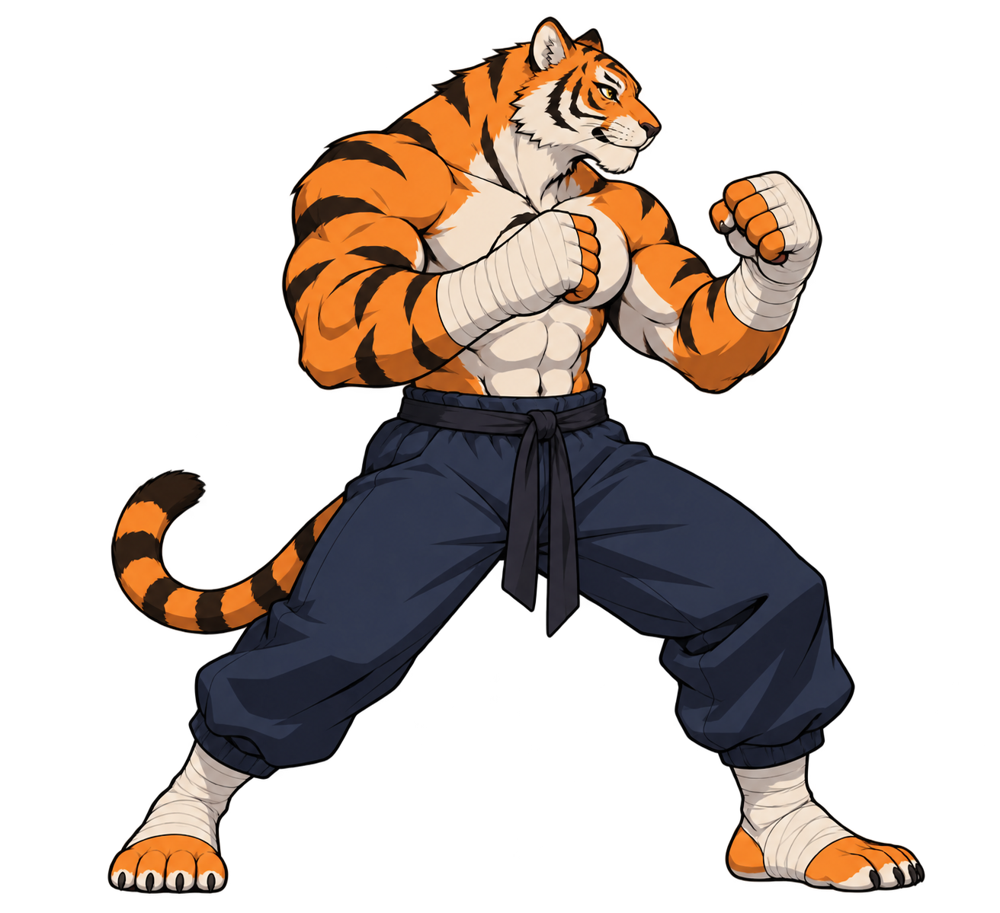
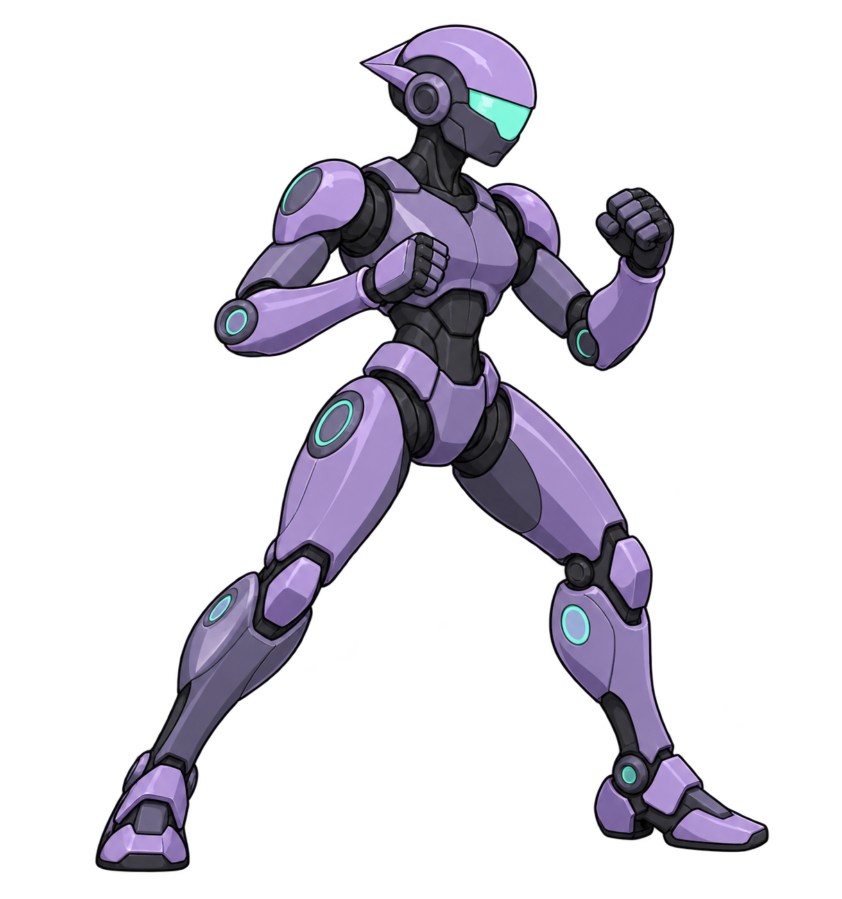

# 차원격투 · Dimension Fight

차원을 넘어 모인 인물들의 격투

여러 세계의 인간·비스트·로봇이 대결하는 2D 애니메이션풍 격투게임.

- 대상 저장소: https://github.com/seoboyoung18/dimension-fight
- 현재 단계: H1 시안100포즈를 사용하는 **H1 대 H1 AI 대전**에 C 콤보와 회전 메치기·풀기를 연결했습니다. S1의 합성 효과음9종·청취 화면에 이어 사용자가 **S2 게임 연결과 초기 소리 켜짐·음량30%**를 선택해 표적·AI 경기 연결과 자동 검증을 완료했습니다. 내장 브라우저의 초기 활성화와 잡기 사건 재생도 확인했습니다. 기존94포즈를 보존하고 메치기6포즈를 추가했으며 걷기12장·0.8초와 기본 공격8종은 유지합니다. CPU가 접근·공격·방어하며60초·2선승·재경기·전체 재시작으로 플레이합니다. 사용자 선택 A안의 빨강·금색 `K O!!`를 사용합니다. 메치기의 자동·실제 확인 범위는 [검수 기록](docs/reviews/h1-throw-revision.md)을 따르며 독립 Chrome/Edge와 난이도·입력 체감 전체를 검증한 것으로 보지 않습니다.
- 개발 방식: [SDD](docs/SDD.md)
- Git 운영: [1인 개발 컨벤션](docs/git-convention.md) — `main`에서 작업하고 검증 후 커밋·push합니다.
- [확정 기획](docs/game-concept.md) · [결정 기록](docs/decisions.md)
- 최근 완료: 사용자가 승인한 [CPU 잡기·풀기 AI-G](docs/specs/h1-ai-grab.md)를 구현하고281개 자동 검사·타입/빌드를 통과했습니다. 접근 잡기·시도부터120F 대기·첫 잡힘 허용/짝수 잡힘의 일회 풀기를 추가하며 기존12F 판단과 전투 수치는 유지합니다. [구현 검수](docs/reviews/h1-ai-grab.md)에 변경 전 기준과 새 자동 결과·실제 확인 범위를 구분했습니다. 인간 난이도·풀기 체감 검수는 남습니다.
- [캐릭터 기준](docs/design/characters.md) · [H1 전투 명세 v0.3](docs/specs/h1-combat-draft.md)
- [작업 계획](docs/plan.md)
- 최근 화면 보완: [코너 피격·일반 KO 잘림](docs/specs/h1-reaction-edge.md)을 수정하고288개 검사·타입/빌드·브라우저 비교를 통과했습니다. 이미지가 벗어난 만큼 표시x만 보정하며 전투 위치·판정과 기존 메치기는 유지합니다. [검수 기록](docs/reviews/h1-reaction-edge.md)에 변경 전/후와 남은 범위를 구분합니다.

## 초기 캐릭터

| H1 인간 | B1 비스트 | R3 로봇 |
|---|---|---|
|  |  |  |

기준 이미지는 단일 자세이며 애니메이션 시트가 아닙니다. 현재 시안은 H1의 `generated`, `derived` 아래 `v2`, `movement-v1`, `combat-v1`, `motion-v1`, `walk-v2`, `attack-motion-v1`, `opposite-limbs-v1`, `grab-v1`, `throw-v1`에 있으며 이전 버전과 탈락 후보도 보존합니다.

## 로컬 실행

Node.js 22.12 이상 필요. 검증 환경은 Windows, Node.js 24.18.0, npm 11.16.0입니다.

```sh
npm ci
npm run dev
```

터미널의 로컬 주소를 엽니다(기본 http://127.0.0.1:5173/). 첫 페이지에서 전투 검수 링크를 누르거나 http://127.0.0.1:5173/combat.html 을 엽니다. **전투 시작** 후 W 점프·A/D 이동·S 앉기·U/I 손·J/K 발·U+I 잡기를 조작합니다. 상대는 검수용 표적이며 선 뒤/앉은 뒤/잡히면1회 풀기를 선택할 수 있습니다. 가까이서 **표적 잡기1회**를 누르면 재개하며 표적이 잡기를 시도합니다. 잡힌 뒤 새 U+I로 직접 풀기를 확인합니다. Esc로 정지/재개하고 포커스가 다른 곳으로 옮겨져도 정지합니다. KO 후 **검수 초기화**로 체력·위치·입력을 복원합니다. AI·60초·라운드 승수는 아래 `match.html`에서 사용합니다. 기존 이동 전용 화면은 http://127.0.0.1:5173/movement.html 에 남아 있습니다.

공격 시안 화면은 동작·포즈 선택, 반복 재생, 좌우 반전·판정 표시를 제공합니다. 선 약손은 6F/3F/15F, 앉은 약발은 8F/4F/18F이며 반복 사이 기본 자세는 검수용 30F입니다. 이 재생은 실제 타격 처리가 아닙니다.

메치기 검수는 **근접 검수 배치**로 체력·입력을 초기화하고 거리84에서 정지한 뒤 시작할 수 있습니다. 실제 이동으로 접근하는 검사와 구분합니다. [메치기 연결 검수 화면](docs/reviews/evidence/h1-throw-review.html)은 같은 공통 전투를 정해진 입력으로 진행하며 재생·1F 이동을 제공합니다. 자동 시나리오를 실제 키 조작 확인으로 보고하지 않습니다.

```sh
npm run verify:assets
npm run verify:sounds
npm test
npm run build
npm run preview
```

`build`는 타입 검사와 정적 빌드를 수행합니다. `preview`는 빌드 결과를 로컬에서 확인합니다. 이미지 검사는 파일 해시·RGBA·512×512·투명 경계·기준점 정렬을 확인하며 외형 검수를 대신하지 않습니다. S1 음원은 `npm run generate:sounds`로 재현하며 `verify:sounds`에서 WAV 규격·해시·파형·조합 혼합을 검사합니다. S2 최종260개 테스트·타입/빌드·음원11파일 바이트 재현/규격·5개 혼합·100포즈 검사를 통과했습니다. 기존 Phaser 청크 크기 경고는 남습니다. 내장 브라우저에서 초기 켜짐·30%와 클릭 전 오디오 미생성, 시작 후9종 준비/running, 메치기 피해18의 붙잡음/충격2회·풀기 피해0의 붙잡음/풀기2회 재생 상태를 확인했습니다. 실제 출력 장치 청취·체감·독립 Chrome/Edge·실제 탭 전환·브라우저 실패 강제 재현은 미확인입니다. 상세 결과는 [게임 효과음 검수 기록](docs/reviews/h1-sound-integration.md), 이전197개 결과는 [S1 검수 기록](docs/reviews/h1-sound-preview.md)에 구분합니다.

**AI 경기 화면:** http://127.0.0.1:5173/match.html — 경기 시작/Enter 후60초·먼저2승으로 진행합니다. CPU는 접근·공격·방어합니다. 시간 종료는 높은 체력 쪽 승리, 동일 체력/동시 KO는 같은 라운드를 재경기합니다. KO18F 뒤 Enter/버튼으로 다음 라운드·재경기를 시작하고 최종 결과에서는 R/버튼으로 승수까지 초기화합니다. Esc는 정지/재개입니다. 기존 `combat.html`의 표적·개별 공격 검수와 초기화는 그대로 사용할 수 있습니다.

[경기 진행 명세](docs/specs/h1-match-flow.md) · [자동/브라우저 검증 결과](docs/reviews/h1-match-flow.md)

승인된 [H1 AI 대전 v0.1](docs/specs/h1-ai-match.md)의 기본기 정책은12F마다 공개된 상태를 보고 닿는 기본기를 순환 선택합니다. 선 방어/후진에 하단을 우선하고 앉은 상대에게 선 강발을 쓰지 않습니다. AI-G 이전에는 아래+뒤를 유지하면 모든 공격을 막거나 피할 수 있었으며, 당시100:100 동률 반복과 CPU 풀기0회는 [기준 재현](docs/reviews/h1-ai-grab-baseline.md)에 보존합니다. 기존 [AI 검수 결과](docs/reviews/h1-ai-match.md)는 당시 자동 검사와 실제 플레이 확인 범위입니다.

AI-G는 보이는 앉기·선 방어/후진에 접근하되 상대가 지상 자유 상태이고 거리96 이내일 때 잡기를 선택합니다. 방어 경직에는 기다리며 시도부터120F 뒤의 판단 차례에 다시 시도할 수 있습니다. CPU가 관찰한 첫 성공 잡힘은 허용하고 두 번째·네 번째에는 첫 판단에서 새 U+I로 한 번 풀기를 시도합니다. CPU가 메친 뒤 H54에 복귀해도 대상의 H72 복귀 전에는 기다립니다. 경기 안내에는 접근 잡기와 U+I 풀기를 반영하고 세부 판단 수치는 접힌 검수 정보에 둡니다.

AI-G 검수는 기존260+정책12+통합9=281개와 타입/빌드를 통과했습니다. 같은 자동 입력의3회 재현에서 아래+뒤 유지에 CPU가2:0 승리했고, 접근 잡기 반복에는 CPU 풀기5회가 발생하면서 PLAYER2:0을 유지했습니다. 빌드 경기의 새 안내·초기30%·시작 후9종 준비/활성·CPU 접근/강손 피해12·소리1회·Esc 정지를 확인했습니다. 지속 앉기·CPU 잡기·양쪽 풀기는 실제 키로 재현하지 못했으며 자동 입력 결과와 인간 난이도/청취 체감은 구분합니다. 상세 범위는 [AI-G 검수 기록](docs/reviews/h1-ai-grab.md)을 따릅니다.

G 이전의 실제 키 검수에서 PLAYER의2:1 최종 승리를 확인했습니다. 사람의 지속 방어/난이도 체감은 계속 확인 중입니다. [전투 확장 v0.2](docs/specs/h1-combat-expansion.md)의 **C 콤보와 G 잡기·풀기는 승인·구현됐습니다.** 가까이 서서 U를 누르고 놓은 뒤 I → J를 이어 누르면 명중 시 연계하며,2타 피해20·3타 피해30입니다. 멀거나 막히면 끊깁니다. C 단계 결과는 [콤보 검수 기록](docs/reviews/h1-combo.md)을 참고하세요.

[회전 메치기 명세](docs/specs/h1-throw-revision.md)에 따라 두 손을3F 이내에 겹쳐 누르면 거리96 이하의 앞 상대를 잡습니다. 선 단독 손은 최대3F(50ms) 기다리며 먼저 놓으면 즉시 시작합니다. 성공하면 몸을 돌려 넘긴 뒤 H36에 바닥 충돌·피해18을 주고 공격자는 H54, 대상은 H72에 복귀합니다. 앞쪽으로 착지하며 좌우 위치는 바뀌지 않습니다. 다운·기상 중 대상은 타격·잡기를 받지 않습니다.

잡히는 순간 H0의 새 U+I부터 H12까지 풀 수 있습니다. H0에 새로 누른 한 손도 H1~3의 반대 손과 조합되며 이전부터 유지한 키는 인정하지 않습니다. 풀기/동시 유효 잡기는 피해0으로 양쪽이 분리됩니다. C 후속 입력에는 손 지연이 없습니다. S2 완료 시점까지 CPU는 잡기·풀기를 선택하지 않았으며, 현재 AI-G에서 같은 공통 입력과 판정으로 연결했습니다. CPU 콤보·점프·난이도 선택은 추가하지 않습니다. 기술은 일반 격투게임의 동작·판정·상대 반응·실패·대응·회복을 함께 검수하며, [메치기 검수 기록](docs/reviews/h1-throw-revision.md)에 당시 자동 검사와 실제 확인·미확인 체감을 구분합니다.

[S 효과음 v0.3](docs/specs/h1-sound.md)의 게임 연결은 `combat.html`과 `match.html`에서 같은9종을 사용합니다. 초기 설정은 **효과음 켜짐·30%**이며 시작/계속하기 등의 사용자 조작으로 활성화합니다. 명중·방어·기본기 헛침과 붙잡음·H36 바닥 충격·풀기를 실제 사건에 연결하고, 동시 사건은 각각 겹쳐 재생합니다. 정지·포커스 이탈·라운드 전환·끄기·음량0은 진행 소리를 비우며 지난 사건을 나중에 재생하지 않습니다. 음원 실패나 활성화 지연 중에도 무음으로 전투를 진행합니다. 마지막 KO/시간 종료 틱에 시작한 짧은 소리는 별도 정지가 없으면 끝까지 들려줍니다.

별도 **청취 시안:** http://127.0.0.1:5173/sound.html — 개별9종·전체 순서 듣기, U→I→J(첫 명중 기준0/13F/24F), 같은 강손 동시2회, 메치기(H0/H36), H12 풀기와 H0 단독 풀기를 비교합니다. 직접 버튼을 누르면 재생하고 다른 버튼은 기존 청취를 교체합니다. 정지·포커스 이탈·탭 숨김·음량0은 소리와 예약을 폐기합니다. 시안 초기30%와 별도로 사용자가 게임 초기30%도 선택했습니다.

WAV9종·제작값·측정 manifest는 `assets/audio/h1/s1-v1/`에 저장하며 `scripts/generate-h1-sounds.mjs`로 합성하고 `scripts/verify-sounds.mjs`로 검사합니다. S2는 기존 음색·길이·상대 크기를 그대로 사용하고 새 패키지 없이 Web Audio로 재생합니다. 게임의 소리 설정은 페이지 안의 라운드/경기 초기화에도 유지하며 새로고침하면 켜짐·30%로 돌아옵니다. 자동 검사와 브라우저 재생 상태 확인은 출력 장치에서 귀로 들은 품질 검증과 구분합니다.

Windows에서 v2 정렬 재현: `pwsh -File scripts/normalize-h1.ps1`. 이동은 `-Version movement-v1`, 전투는 `-Version combat-v1`, 중간 포즈는 `-Version motion-v1`, 교차 보행은 `-Version walk-v2`, 이전 시안은 `-Version v1`을 지정합니다. 모든 자세에 대기 기준 공통 배율을 적용하며 점프에는 가상 지면을 사용합니다. ImageGen 재생성이 아닌 정렬 작업이며 정확한 프롬프트는 각 버전의 `prompts.json`과 각 재생성 프롬프트 JSON에 있습니다. `npm test`는 전투·입력·경기·AI와 C/G 검사를 수행합니다. 검사 결과는 완성 스프라이트나 체감 난이도 승인을 뜻하지 않습니다.

[시안 작업 명세](docs/specs/h1-asset-preview.md) · [시안 검수 기록](docs/reviews/h1-preview.md)

[앉기·하단 작업 명세](docs/specs/h1-crouch-preview.md) · [v2 검수 결과](docs/reviews/h1-crouch-preview.md)

[입력·이동 명세](docs/specs/h1-movement.md) · [이동 검수 결과](docs/reviews/h1-movement.md)

[전투 판정 구현 명세](docs/specs/h1-combat-core.md) · [전투 로직 검증 결과](docs/reviews/h1-combat-core.md)

[전투 포즈·화면 명세](docs/specs/h1-combat-preview.md) · [전투 화면 검수](docs/reviews/h1-combat-preview.md)

[모션 보완 기준](docs/specs/h1-motion-polish.md) · [KO 선택·표시 기준](docs/specs/ko-art-options.md) · [보완 검수 결과](docs/reviews/h1-motion-ko.md)

[공격7종 프레임 명세](docs/specs/h1-all-attack-frames.md) · [공격 보완 검수](docs/reviews/h1-all-attack-frames.md) · [동작 전후 비교](docs/reviews/evidence/h1-motion-comparison.html)

새 공격 그림 정렬은 `pwsh -File scripts/normalize-h1.ps1 -Version attack-motion-v1`로 재현합니다. 비교 화면의 동작 선택에서 공격8종을 고른 뒤 느린 재생·1F 이동·왼쪽 보기를 사용할 수 있습니다.

강손·강발4종의 반대 손발과 전신 회전은 [수정 명세](docs/specs/h1-opposite-limbs.md)를 따릅니다. `-Version opposite-limbs-v1`로26장을 정렬합니다. 비교 화면은 강공격의 이전26포즈와 보완본을 같은 시간에 재생하며 아래에서 약/강의 실제 공격 손발도 나란히 확인할 수 있습니다.

선 강발은 [첫 발차기 타격 기준](docs/specs/h1-heavy-kick-contact.md)에 따라 다리가 완전히 펴진12~15F의 발끝에서 타격하고16F부터 하강·회복합니다. 비교 화면의 **공격 판정 표시**로 발끝과 빨간 영역을 확인할 수 있습니다. 준비12/유효4/회복36F이며 총52F·피해16을 유지합니다. [검증 결과](docs/reviews/h1-heavy-kick-contact.md)를 참고하세요.
