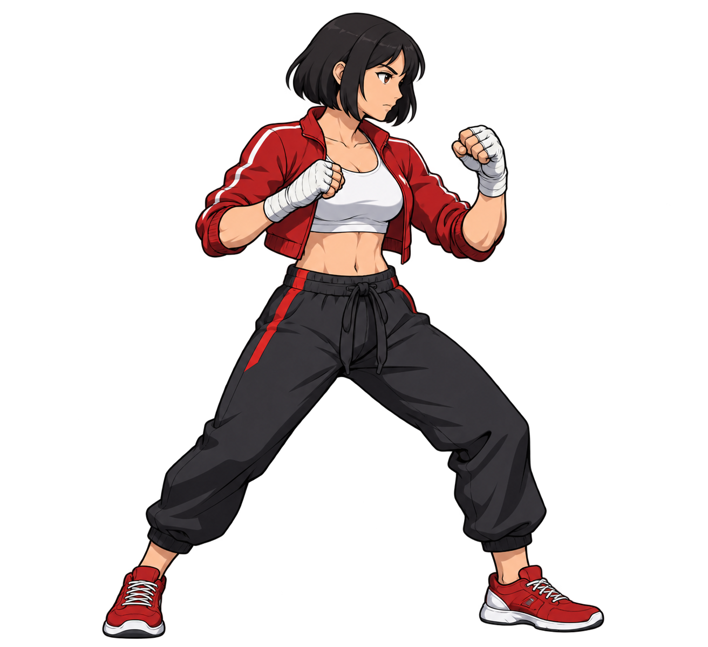

# 차원격투 · Dimension Fight

차원을 넘어 모인 인물들의 격투

여러 세계의 인간·비스트·로봇이 대결하는 2D 애니메이션풍 격투게임.

- 대상 저장소: https://github.com/seoboyoung18/dimension-fight
- 현재 단계: H1 대기·약손 시안 4장과 브라우저 검수 화면 준비. 대전 기능은 아직 없습니다.
- 개발 방식: [SDD](docs/SDD.md)
- [확정 기획](docs/game-concept.md) · [결정 기록](docs/decisions.md)
- [캐릭터 기준](docs/design/characters.md) · [H1 전투 명세 v0.3](docs/specs/h1-combat-draft.md)
- [작업 계획](docs/plan.md)

## 초기 캐릭터

| H1 인간 | B1 비스트 | R3 로봇 |
|---|---|---|
|  |  |  |

기준 이미지는 단일 자세이며 애니메이션 시트가 아닙니다. 생성 원화와 정렬된 시안은 H1의 `generated/v1`, `derived/v1`에 별도로 보존합니다.

## 로컬 실행

Node.js 22.12 이상 필요. 검증 환경은 Windows, Node.js 24.18.0, npm 11.16.0입니다.

```sh
npm ci
npm run dev
```

터미널의 로컬 주소를 엽니다(기본 http://127.0.0.1:5173/). 포즈 선택·약손 재생·좌우 반전·판정 표시를 검토할 수 있습니다. 약손은 준비 6F / 유효 3F / 회복 15F, 반복 사이 대기는 검수용 30F입니다. 아직 WASD 전투 조작은 제공하지 않습니다.

```sh
npm run verify:assets
npm run build
npm run preview
```

`build`는 타입 검사와 정적 빌드를 수행합니다. `preview`는 빌드 결과를 로컬에서 확인합니다. 이미지 검사는 파일 해시·RGBA·512×512·투명 경계·기준점 정렬을 확인하며 외형 검수를 대신하지 않습니다.

Windows에서 정렬 재현: `pwsh -File scripts/normalize-h1.ps1`. 생성 원화를 읽어 같은 배율로 축소하고 투명 여백만 배치합니다. ImageGen 재생성이 아닌 정렬 작업이며 프롬프트는 `generated/v1/prompts.json`에 있습니다.

[시안 작업 명세](docs/specs/h1-asset-preview.md) · [시안 검수 기록](docs/reviews/h1-preview.md)
