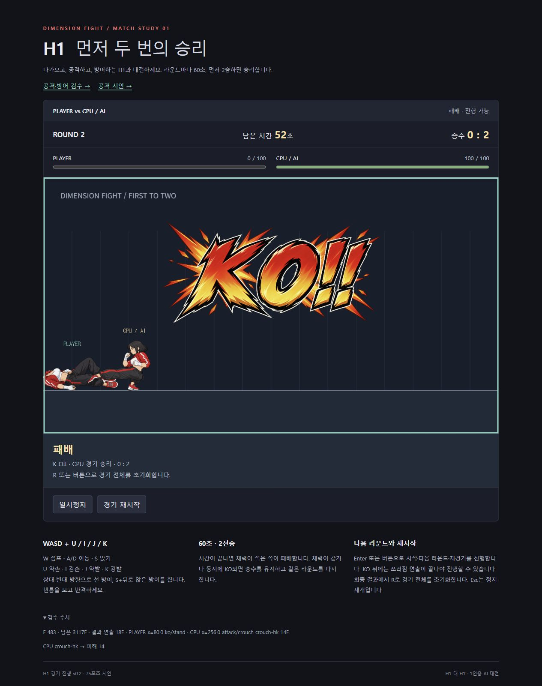

# H1 AI 대전 v0.1 검수 · 2026-10-02

사용자가 v0.1 확인 요청에 “계속 진행하자”라고 답해 P1~P3와 상세안을 승인했다. [명세](../specs/h1-ai-match.md)에 따라 `match.html`에서 CPU의 접근·기본기8종 순환·뒤 방향 방어를 연결했다. 12F마다 공개된 상태만 관찰하고 공격은1F 펄스다. 기존 체력·피해·판정·75개 이미지와60초/2선승 경기 규칙은 유지한다. 콤보·잡기·소리는 추가하지 않았다.

## 자동 검사

- 기존78개와 AI15개를 합쳐 **93개 테스트 통과**. 타입 검사·Vite 빌드·에셋 검사도 통과했다. 기존 Phaser500kB 청크 경고는 남는다.
- A01~A10: 0/12/24F 판단·판단 사이 유지·공격1F·공개 상태 투영·현재 PLAYER 입력 비참조·8종 선택/순환·선/앉은 거리 경계/좌우·강발153/154/160/161·선 방어 하단 우선·위협 높이/준비/유효/회복·행동 잠금·공중 접근160/161·공통 강발12F/피해16/단타를 검사했다.
- A11~A14: 정지 시 입력 제거/시계·커서 보존, CPU 공격 중 정지/재개, 종료 후 같은 렌더의 후속 AI 차단, 라운드/재경기/전체 재시작3회,30/60/144Hz의 실제 AI 경기 결과 일치를 검사했다.
- A15: 체력/위치 조작 없이 표준 시작의 무입력 PLAYER를 CPU가 KO로2:0 승리했다. PLAYER의 아래+뒤 지속 입력은60초 동안100:100을 유지해 동률 재경기가 됐다. 이는 자동 입력 검사이며 실제 브라우저에서 키를60초 유지한 검증과 구분한다.
- 첫 AI 검사에서 A02의 준비 위치를400/600(거리200)으로 두고 공격 시작을 기대해 null 접근 오류가1회 났다. 명세상 공격 불가 거리였으므로 fixture를500/600(거리100)으로 고쳤고, 입력 독립성/불변성 기대값과 제품 구현은 유지했다.

## 실제 브라우저

Codex 내장 브라우저의 일반 버튼·키 입력으로 수행했다. 경기 상태 변경이나 AI 전용 검수 우회 기능은 만들지 않았다.

1. 로딩 후 준비 화면의100/100·60초·0:0과 새 CPU / AI 표시를 확인했다. 시작 후 F15에 CPU가880→820으로 접근했다.
2. PLAYER 무입력으로 ROUND 1은 F483에 KO, 표시52초·0:1이었다. Enter로 ROUND 2가 시작되며 체력/시간/위치가 복원됐고 같은 흐름으로 최종0:2·패배·A KO 이미지·재시작 버튼이 나왔다.
3. R로 ROUND 1 준비·체력100/100·60초·0:0·F0·시작 위치·타격 기록 없음이 복원됐다.
4. 별도 플레이에서 D/J와 J 재입력으로 반격했다. 정지한 F579 화면에서 PLAYER12, CPU80을 확인했다. PLAYER 약발2회분의 피해20이 실제 적용됐다. PLAYER 최종 승리는 이번 검수에서 달성하지 못했다.
5. 새 ROUND 2에서 J를 재입력해 F96에 `PLAYER stand-lk → 피해 0`, 양쪽 체력100을 확인했다. CPU가 PLAYER 약발을 실제로 방어했다.
6. Esc/Enter로 진행 및 결과 정지·재개를 확인했다. 정지한 결과에서 다음 라운드 버튼이 비활성화됐다. KO15F에서 재개와 Enter를 곧바로 연달아 눌렀을 때 조기 다음 입력이 예약되지 않았고,18F 완료 후 버튼으로 다음 라운드가 시작됐다. 마지막에 준비 화면으로 다시 로딩했다. 검사 시점 warn/error 로그는0이었다.

기존 검수 탭의 새로고침이 브라우저 제어 시간 초과로 실패해 같은 브라우저의 새 탭에서 검수했다. 짧은 A 또는 S+A 키 펄스로는 PLAYER의 지속 방어를 재현하지 못했다. 이를 게임의 방어 성공이나 방어 기능 실패로 단정하지 않으며 자동 방어 입력 검사와 구분한다.

## 증거와 남은 확인

- [CPU 최종2승·KO·패배](evidence/h1-ai-cpu-win.png)
- [R 전체 초기화](evidence/h1-ai-reset.png)
- [PLAYER 반격·CPU 체력80](evidence/h1-ai-counterattack.png)
- [CPU가 PLAYER 공격 방어·피해0](evidence/h1-ai-defense.png)

A16의 실제 플레이 확인은 위 범위까지다. PLAYER의 지속 방어·최종 승리, 독립 Chrome/Edge, 창/탭 비활성화와 이미지 실패/재시도는 이번에 검증하지 않았다. 전체 모션의 자연스러움·전투 난이도·재미는 사용자 체감 검수가 필요하다. 양쪽 끝 쓰러짐 그림 일부 잘림과 아래+뒤로 모든 기본기를 막거나 피할 수 있는 기존 제약은 남아 있다.

## 추가 플레이 검수와 확장 상세안 · 2026-10-02

기준 `main/d1394cf`. 게임 코드·공격 수치·이미지를 변경하지 않고 기존93개 테스트·타입/빌드·에셋 검사를 다시 통과했다. 기존 Phaser 청크 크기 경고는 유지한다. 의존성이 없는 작업 환경에서 `npm ci` 후 검수했다. 첫 설치는 환경 접근 제한으로 실패했으며 승인된 재시도로 설치됐다. 패키지/잠금 파일 변경은 없다.

### 실제 입력으로 확인한 경기

Codex 내장 브라우저에서 빌드 화면 `http://127.0.0.1:4173/match.html`의 버튼과 키를 조작했다. 체력/위치/시간/AI 상태를 주입하지 않았다. 아래 반복 입력은 자동으로 보낸 짧은 키 펄스이며 사람의 손 조작과 동일한 난이도 표본으로 보지 않는다.

| 라운드 | 입력/결과 | 종료 화면 수치 |
|---|---|---|
| 1 | J 반복 반격, PLAYER 승리 | F609·남은50초·PLAYER54/CPU0·승수1:0 |
| 2 | J 반복 반격, CPU 승리 | F519·남은52초·PLAYER0/CPU90·승수1:1 |
| 3 | D+J 반복 접근/반격, PLAYER 최종 승리 | F632·남은50초·PLAYER40/CPU0·승수2:1 |

각 라운드는 다음 라운드 버튼으로 전환했다. 마지막에는 `승리!`, KO 표시,2:1과 재시작 버튼을 확인했다. [승리 화면](evidence/h1-ai-player-win.jpg)을 저장했다. 첫 라운드의 중간 F113에서 PLAYER100/CPU80·약발 피해10도 확인했고 Esc/계속하기로 정지·재개했다. 기존 'PLAYER 최종 승리 미확인'은 이 추가 검수로 보완한다.

다른 경기에서는 S+A 짧은 펄스를 반복했으나 첫 라운드 F549에 PLAYER0/CPU100, 둘째 F515에 최종0:2였다. 읽은 사건 중 PLAYER 방어의 피해0을 확인하지 못했다. 도구는 지속 키 누름을 제공하지 않아 이 결과로 아래+뒤 유지의 성공/실패를 판단하지 않는다. 지속 입력 자동 검사의100:100 동률과 모순되는 결과로 취급하지 않는다.

### 환경 한계와 해석

초기 개발 화면5173에서 짧은 키/접근성 읽기를 반복했을 때 F0→14→32→44 정도만 진행했다. 문서 저장 이후 로딩 화면도 관찰했다. 원인을 게임 난이도/방어 버그로 확정하지 않고, 빌드 화면4173에서 스크린샷과 키 입력을 함께 사용해 위 경기를 완료했다. 전체 페이지 캡처1회는 실패했으며 뷰포트 JPEG로 승리 수치를 저장했다.

확인한 브라우저 warn/error 로그는0이다. 브라우저 독립 Chrome/Edge 실행·실제 사람이 유지하는 방어·인간 반응 난이도·최종 모션 품질·이미지 실패/재시도는 여전히 미확인이다. 플레이어가 기존 기본기로 이길 수 있음은 확인했지만 '쉬운 AI'라는 결론이나 균형 잡힌 승률을 주장하지 않는다.

### 명세 검산

[확장 v0.2](../specs/h1-combat-expansion.md)에 콤보 입력/취소창·거리·잡기 입력 충돌/풀기/동시 처리·오디오 사건을 상세 제안했다. 현재 순수 전투 함수에 미래 취소 상태를 실험적으로 주입한 계산은 중앙3타 거리109 성공/110 실패와 취소 마지막F 성공/+1F 방어 가능을 확인했다. 제품에 콤보가 구현됐다는 검증이 아니다. 새 잡기 수치·3F 지연·음색·CPU 확장 전략은 승인 전이며 코드/에셋/음원은 추가하지 않았다.
