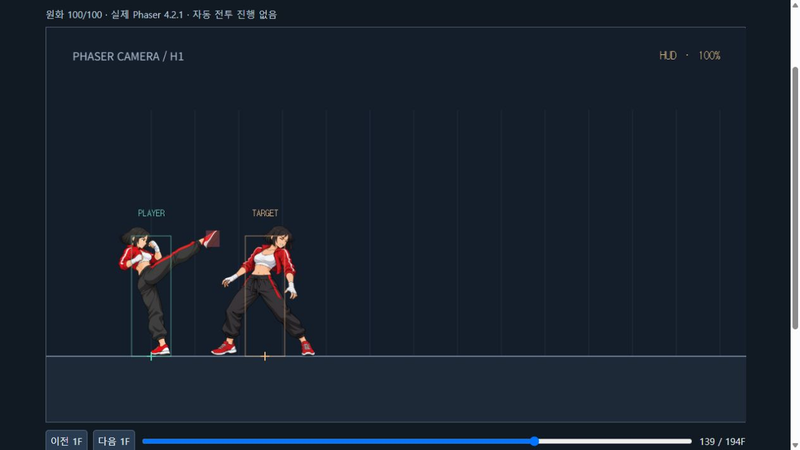
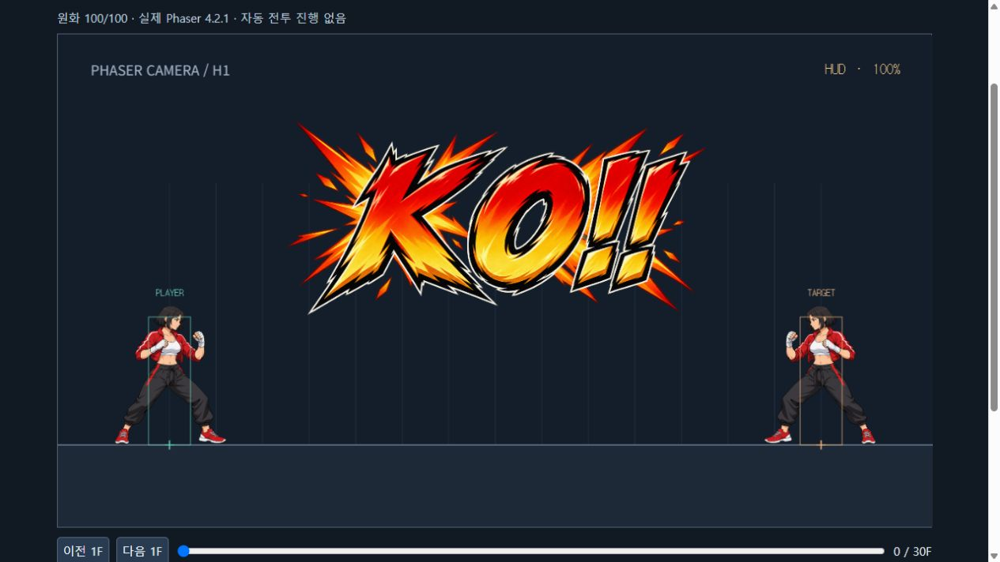

# H1 코너 전환·거리 대응 카메라 A 검수

2026-10-03 · 변경 전 `3fe3f23` · [승인 명세](../specs/h1-camera-framing.md). 사용자가 **A · 거리 대응 카메라 적용**을 선택해 제품에 연결했다. 아래 시안 검사는 승인 전의 근거이며 제품 검수는 뒤에 별도로 기록한다.

## 확인한 문제

현재 코너 대기에는 표시dx가 있고 보행·점프·기본 공격에는 없다. 코너에서 같은 논리 루트로 대기→공격을 바꿔도 그림은 옆으로 이동한다. 모든 정상 포즈를 하나의 개별 보정 범위로 묶으면 이 차이는 줄지만, 공격 그림과 승인된 실제 판정이 그 보정량만큼 어긋난다.

| 측정 대상 | 실제 alpha>0 수평 범위/결과 |
|---|---|
| 정상70포즈 | 원화 [47,468), 루트 기준 좌130.625/우132.5px |
| 일반 hit2·KO3 포함75포즈 | 위와 동일한 합집합 |
| 현재 선택94포즈 | 원화 [46,468), 좌131.25/우132.5px |
| 원래 메치기 곡선·회전 포함 | H35 대상이 루트에서 최대191.645576927px |
| 승인한 공통 표시 여유 | 위 값을 올림한 좌우192px |

등록100개 중 옛 밀치기6개는 현재 선택되지 않는다. 측정 기준은 픽셀의 중심점이 아니라 모든 alpha>0 셀의 양 끝이다. 메치기는 양쪽 코너/중앙·방향·거리72/84/96·선앉음·공격자0/1·양 역할의10,512표시 상태에서 확인했다. [작은 측정 기록](evidence/h1-camera-measurements.json)에 원화 해시와 수치 근거를 보존한다.

양 끝에서 정상 포즈를 모두 담는 최소 관측 범위는[-50.625,1330.625], 폭1381.25다.1280보다 넓어 공통 평행이동만으로 해결할 수 없다. 개별 루트를50.625px 옮기면 승인된 강발 발끝의25px 폭을 벗어날 수 있다. 그림 쪽으로 판정 안내만 옮겨 숨기는 방식은 사용하지 않는다.

## 시안의 구분

[비교 화면](evidence/h1-camera-review.html)은 같은 공통 입력 상태에 현재 표시/A거리 대응/B고정 전체 보기를 선택한다. 새 안은 기존 개별dx를 빼고 두 그림·이름표·원래 판정·논리 루트·배경에 같은 변환을 적용한다.

A는 가까울 때 기존100% 크기를 유지하고 필요할 때만 화면을 이동하거나 축소한다. B는 항상85.1064%다. 양 끝80/1200에서는 두 안 모두 기본 키240이204.255로 보인다. 이는 화면상 최대 약14.9% 축소이며 전투 수치 변화가 없어도 사용자에게 보이는 크기가 바뀐다. 현재 포즈의 크기로 카메라를 재계산하지 않아 같은 루트의 포즈 전환 때문에 화면이 움직이지 않는다.

## 확인 결과

변경 전 게임의295개 회귀 검사를 통과했다. 독립 순수 검사에서94포즈의 실제 alpha-cell 투영과11,252회 표시 검사(22,504몸체),384회 종료 스냅샷을 확인했다. 여기에는24개 검수 시나리오의1,648F와 별도 전투/표시 경계가 포함된다. M160 임시값은 실제 공중 메치기 범위를 담지 못했고 측정값을 반영한 M192에서 통과했다. 파일은 OS 임시 경로에 둔 별도 검사이며 제품 테스트 수295에 더하지 않는다.

같은 루트에서는 포즈·나이와 무관하게 같은 카메라, 기본8공격/발끝 사각형의 공통 변환, 보행/점프·메치기·풀기·KO/시간 종료·정지, 원래 연출/입력 결과 불변과 현재 모드의 기존 표시 일치를 검사했다. 이는 추가 보정 때문에 생기는 기준점 점프의 해결이며 원화에 그려진 지지발 움직임이나 접촉 오차 전체를 수정하는 것은 아니다.

초기 비교 시안이 고정된 근접/양끝 배치뿐이어서 실제 거리 변화에 따른 줌을 볼 수 없다는 독립 검토를 반영해 접근·후퇴 장면을 추가했다. 추가 계산 검사에서 좌우1,082F 입력 재생·반대 소유자1,082F, 거리900/896/892 경계·연속성·좌우 반사와24개 정지/종료 사례를 확인했다. 브라우저에서 양 끝85.11%→거리896의100%→근접100%→양 끝 복귀F540 자동 정지를 확인했다. 이 검사는 제품 테스트 수에 더하지 않는다.

## 적용 선택과 검수의 한계

기존 애니메이션 명세는 기본 표시 키240을 확정했고 그림/판정의 공통 발 기준을 요구한다. 원화·전투 판정을 유지하면서 이 문제를 해결하는 새 화면 규칙은 위 사용자 선택으로 확정했다. A와 B/적용 전 방식은 비교 화면에 보존한다.

시안과 자동 검사는 실제 키 조작·사람의 난이도/연출 체감·독립 Chrome/Edge·Phaser 카메라 연결을 대신하지 않는다. 렌더러·종료/정지·기존 코너 보정 검사와 문서를 함께 바꿨으며 실제 경기 연결 검수 결과는 다음 절에 기록한다.

## 승인 A 제품 구현·자동 검사

`combatVisuals`의 개별/쌍 표시x 보정을 제거하고 원래 월드 연출을 반환한다. `h1-camera.ts`가 논리x만으로 공통 변환을 계산하며 두 전투 화면이 같은 Phaser 연결 함수를 사용한다. 제목·KO·결과는 별도 항등 카메라로 표시한다. 바닥은 실제 지면600을 유지하면서 축소된 가시 영역까지 채운다. 사용하지 않는29포즈 런타임 표/생성기는 제거하고 적용 전 코드·표는 [동결 모듈](evidence/h1-camera-previous.mjs)에 보존했다.

- 기존 개별 보정 코드에 새 계약의7개 검사를 먼저 실행해6실패/1통과를 확인했다. 예를 들어 논리x80에 표시x98.75가 반환돼 원래 루트 계약에 실패했다.
- 기존 시각18개 검사를 새 계약으로 교체하고 카메라6개를 추가했다. 최종 전체 **301/301**, 관련 시각 **24/24**, TypeScript 포함 빌드를 통과했다. 기존 Phaser 청크 크기 경고는 유지한다.
- 실제 PNG alpha>0 셀 oracle로 좌우/중앙·반전·94포즈,8공격 전 age·걷기12·점프3, 메치기H0~72(거리72/84/96·선앉음·소유자0/1)와 풀기/KO/시간 종료를 확인한다. 원래 y/회전/높이와 전투 결과 불변도 검사한다.
- 공통 이동541F×좌우×소유자에서 거리896을 양방향 통과하고, 강발 발끝과 실제 타격 사각형의 같은 변환, 정지·새 라운드·동률 재경기·전체 재시작을 확인한다. Phaser 설정의 단위 대역 검사와 아래 실제 브라우저 행렬 검사를 구분한다.
- 독립 코드 검토에서 추가 수정 사항을 찾지 못했다. 적용 전 동결본은7,860상태에서 원본과 동일했고 A 비교는2,730상태에서 제품 함수와 동일했다. 기존 검수 HTML의 DOM draw1,118회는 별도 Node 대역 검사이며 실제 브라우저 픽셀 검사 수가 아니다.

## 실제 Phaser·빌드 브라우저 확인

[Phaser 연결 화면](evidence/h1-camera-phaser.html)은 제품의 원화·표시·카메라 함수를 그대로 사용하고 실제 POST_RENDER의 카메라 행렬을 검사한다. 초기 배치와 공통 입력을 재현하는 별도 검수 화면이며 실제 게임에서 키를 눌러 양 끝에 도달한 기록과 구분한다.

| 확인 장면 | 실제 결과 |
|---|---|
| 양 끝80/1200, 고정 KO 배너 표시 | z0.851063830, HUD100%/항등 오차0, 월드 행렬 최대 오차1.136e-5px |
| 왼쪽 코너 선 K 유효F139 | z1·pan112, 그림/루트/발끝 사각형 공통 이동, 상대 피해16/HP84 |
| 오른쪽 메치기 H35·H36 | z1·pan-112, 공중/바닥 전환과 HP100→82, 바닥 충돌 피해18 |
| 오른쪽에서 접근 F55→F56 | 거리900→896, z0.996884735→1, pan109.657321→112, 행렬 오차 최대2.282e-5px |
| 모든 위 장면의 카메라 분리/바닥 | 양쪽 ignore·renderList 분리 PASS, HUD zoom1/scroll0, 바닥 화면 포함 PASS |

프레임 조작 직후에는 ‘렌더 확인 중’을 표시하고 새 렌더 후에만 PASS를 갱신한다. 양 끝에서 바닥은 화면x-68.085~1348.085, y600~1212.766으로 하단/양쪽을 채운다. 대기·후진·점프·공격에 따른 카메라 추가 루트 점프는 순수 검사와 실제 화면을 함께 확인했다.

빌드4174에서 표적/AI 경기 이미지 로딩·시작·Esc 정지를 확인했다. 표적의 근접 배치에서 실제 U+I가 잡기 시도와 붙잡음 H2/효과음 사건1로 이어졌고, 검수 초기화 후 F0·루트400/880·HP100:100으로 복귀했다. 이 실행에서는 배경 탭 진행이 짧아 물리 키 입력부터 H36까지 완료된 것을 확인하지 못했으므로 피해18 브라우저 근거는 위 별도 공통 입력 장면이다. 전투 코어·AI·입력·음원·원화 파일은 변경하지 않았다.

최종 표적·AI·A 비교·Phaser·기존 메치기 검수의 warn/error는 모두0이었다. 기존 메치기 검수의 현재 표시가 제품 A를 사용하고 이전136px 비교는 고정 이력으로 유지되는 것도 확인했다. 승인 전 [근접](evidence/h1-camera-near.png)/[양끝](evidence/h1-camera-far.png) 이미지는 ‘미승인 시안’ 표기를 포함한 당시 기록으로 보존하며 제품 적용 증거로 사용하지 않는다.

다음 확인은 사람이 직접 양 끝을 오가며 느끼는 줌·팬 자연스러움, 동작별 지지발/접촉, 난이도·청취와 독립 Chrome/Edge다. 자동 경계·좌표 검증을 이 체감 검수의 통과로 해석하지 않는다.
