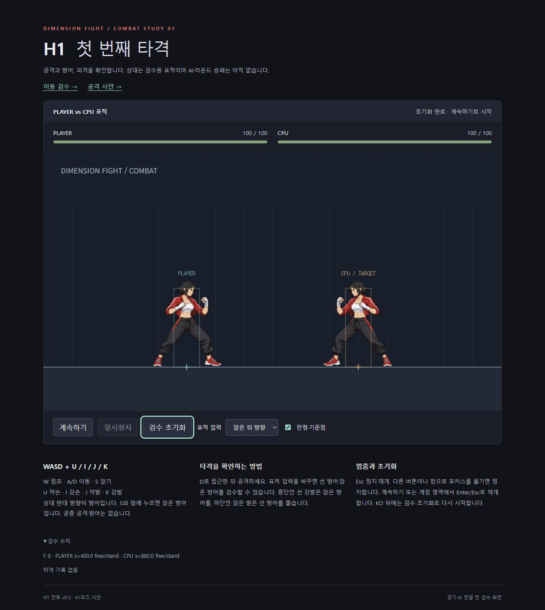

# H1 전투 포즈·화면 검수 · 2026-10-01

상태: **41포즈 시안 연결과 전투 검수 화면 구현. 최종 외형·전체 경기 완료 전.** [단계 명세](../specs/h1-combat-preview.md)와 승인된 전투 v0.3을 기준으로 확인했다.

## 연결 결과

- 기존16장에 공격6종×3, 선/앉은 방어·피격4, 쓰러짐3을 더해 고유41장이다. `generated/combat-v1` 원화25장과 재생성3장, 정확한 프롬프트를 보존하고 `derived/combat-v1`에는 선택된25장을 정렬했다.
- 앉은 약손 회복/강손 준비의 확대와 앉은 강발 준비의 조기 발 뻗음은3개 `-v2` 원화로 보완했다. 선택된 출력의 상단은 각각209/208/210px이다. 공통 배율384/1120을 유지하고 포즈별 높이로 재확대하지 않았다.
- 파일 저장 시각순으로 임시 복원하던 중 앉은 강손 유효/회복 등이 반대로 매핑된 것을 육안 확인했다. 비동기 완료 순서가 달랐으며, 이름이 붙은 도구 반환 경로와 대조해 교정한 뒤 정렬·에셋 검사·빌드를 다시 수행했다.
- `combat.html`은 WASD·U/I/J/K를 전투 로직에 전달하고 그림은 같은 공격 나이로 선택한다. 상대 입력 없음/선 뒤/앉은 뒤는 검수용이며 AI가 아니다. KO 후 전투 상태는 고정하고 쓰러짐만6F×3장 재생한다.

## 자동 검사

- `npm test`: **58/58 통과**. 기존53개 회귀와41경로·8공격 전 구간/종료·방어/피격 자세·KO 경계·잘못된 구간 실패5개.
- `npm run verify:assets`: 원본/파생 해시·RGBA512×512·투명 경계·공통 배율·루트(256,448) 및25개 새 출력 통과. 기존4+8+8장도 검사한다. 보존본/대체 후보는 고유41포즈 집계와 구분한다.
- `npm run build`: 타입 검사 및 HTML3개 정적 빌드 통과. 기존 Phaser 공통 청크 약1.38MB의500kB 초과 경고는 남아 있다.
- Git 비교에서 SDD 원문, 기준 이미지3장, 이전 v1/v2/movement-v1은 변경 없음.

## 실제 브라우저 확인

Windows Codex 내장 브라우저에서 개발 서버를 사용했다. Chrome·Edge 개별 검증으로 간주하지 않는다.

| 확인 | 관측 |
|---|---|
| 이미지 미배치 | 로딩 실패 안내·시작 비활성·다시 불러오기 표시. 이미지 정렬 완료 후 Vite 새로 로딩으로 준비 상태 복구. 재시도 버튼 클릭 자체는 별도 미검증 |
| D 접근 + U | CPU 체력100→92, 선 약손 피해8 기록 |
| 상대 앉은 뒤 + U | 체력100 유지, guard/crouch와 방어·피해0 기록 |
| 상대 앉은 뒤 + K | 체력100→84, 선 강발 피해16 기록 |
| Esc 정지 + D/U | F1451, 위치792/928, 체력100/84 유지 |
| Enter 재개 후 K 반복 | CPU0, KO 표시와 최종 쓰러짐 포즈. 전투F2308 고정 |
| KO 후 D/U | F2308·위치1072/1200·체력100/0 유지, 추가 피해 없음 |
| 검수 초기화 | F0, 위치400/880, 양쪽100, free/stand, 타격 기록 없음, 정지 상태 복원 |
| 오류 로그 | 최종 검사 탭의 warn/error 없음 |

검사 중 에셋 재정렬에 의한 Vite 새로 로딩이 발생해 최종 에셋 이후 별도 탭에서 중단·정지·KO·초기화를 다시 확인했다. 표적 입력 선택은 검수 환경 설정이므로 초기화 뒤에도 유지되며, 선수의 자세는 다음 재개 갱신에 반영된다.

## 남은 외형 문제와 미확인 범위

- 선 약발/강발의 지지발 x 위치와 상체 높이가 준비·유효·회복 사이에서 달라 연결이 흔들린다. 프레임 수를 채운 것과 완성 품질 승인은 다르다.
- 오른쪽 경계 CPU x1200의 쓰러짐 최종 포즈에서 머리 쪽이1280 화면 밖으로 일부 잘린다. PNG 캔버스 자체의 잘림 검사는 통과했지만 화면 경계 검수에서 발견한 별도 문제다. 전투 위치/경계를 임의로 바꾸지 않았으며 표시/이미지 보완이 필요하다.
- 모든 공격을 좌우·코너·여러 표시 크기에서 육안 확인한 것은 아니다. 전체8종 키 입력과 방어9조합은 자동 검사이며, 실제 동시 키 유지·모든 프레임의 타격점 일치·걷기/발차기 연결·타격감·성능은 추가 확인한다.
- 경기 시계·승수·동률 재경기·AI·캐릭터 선택은 후속 단계다. 기존 전투 수치는 변경하지 않았다.
- [Notion 트러블슈팅](https://app.notion.com/p/3eca2fe05e6881c29eabd7435a688947)에 확대·비동기 매핑·남은 경계 문제를 기록하고 재조회했다.

다음: 발차기/경계 그림 보완, 승인된60초·먼저2승·동률 재경기·다음 라운드/경기 재시작의 상태 계층과 명세 기반 테스트, 이후 AI 연결.
