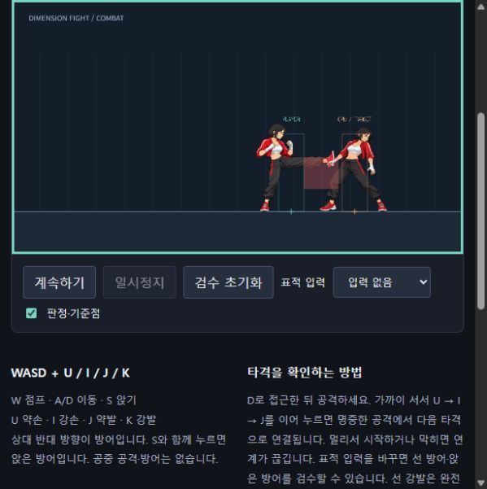
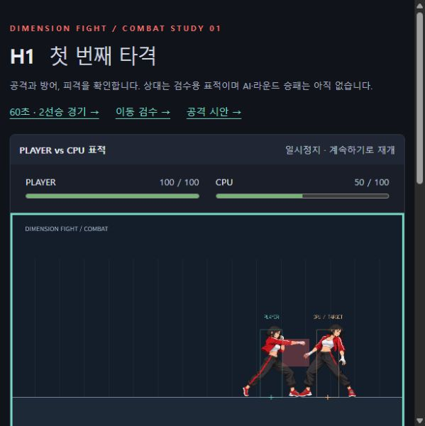

# H1 C 콤보 검수

2026-10-03. 사용자의 “C콤보부터 하자”에 따라 [확장 v0.2 §6](../specs/h1-combat-expansion.md)의 C만 구현했다. 기존8공격 수치·75포즈·CPU 선택은 유지하며 G 잡기·3F 손 지연·S 효과음은 승인 대기다.

## 반영 내용

선 U→I→J 한 경로다. U age3~12에 I를, 연계 I age5~22에 J를 하나 예약한다. 비방어 명중을 확인한 뒤 각각 회복age9~12/13~22에 후속 공격age0으로 전환한다. 양 끝 포함이며 기존 공격 나이를 증가시킨 뒤 명령을 읽는다. 새 공격마다 새ID·빈 타격 이력을 쓴다.

방어·헛침·피격/상호 타격·창 만료에서 예약과 자격을 제거한다. 정지는 예약키만 제거하고 공격 나이·단계·명중 자격은 유지한다. KO/시간 종료·라운드/재경기/경기 초기화는 전체 연계를 비운다. 잘못된 키는 기존 올바른 예약을 덮지 않으며 J 이후는 정상 회복한다.

`match.html`과 `combat.html`에 조작 안내를 넣고 개발용 검수 수치에 연계 단계·명중·예약을 표시했다. 경기 정지 때 예약을 지우며 전투 객체가 바뀌어도 마지막 타격 기록을 유지하도록 초기화 판별을 프레임0에 한정했다.

## 자동 검증

`npm test`: 기존93+새18=**111개 통과**. `npm run typecheck`, `npm run build`, `npm run verify:assets`도 통과했다. 이미지75개 경로·해시 유지. 기존 Phaser 번들 크기 경고는 남는다.

| 기준 | 확인 결과 |
|---|---|
| C01 지정 경로 | U→I/→J만 연결, 단독 I·앉은 U·공중·K 제외. 자유 U+I는 기존 강손 우선이며 손 지연 없음 |
| C02 입력/취소 창 | U age3~12·I age5~22의 모든 입력F, 직전/직후, 최초/마지막 취소F. 후속은age0, 같은 틱 중복 증가 없음 |
| C03 거리/연속성 | 거리72·109/110·135/136·139/140, 두 선수/좌우/양쪽 코너. 마지막 취소에서도 상대 반격·점프·후진 입력이 경직으로 차단된 채 접촉 |
| C04 중단/단타 | 방어·헛침·선행 피격·동시 타격·KO, 타격ID/각타1회, 피해20/30, 잘못된/다중키와 기존 예약, J→U 취소 없음 |
| C05 상태 정리 | 유지/반복 키·정지 후 새 입력·시간 종료/동률·다음 라운드/초기화, 과거 스냅샷 불변. 공격 중 방향/S/W에도 선 자세·방향 유지 |
| R01 회귀 | 기존 이동·전투·포즈·입력·경기·AI93개 통과. CPU 새 콤보 전략 추가 없음 |

중앙에서 첫 U 접촉 거리d에 기존 밀려남을 적용하면 U는 d<140,2타는 d+24<160 즉 d<136,3타는 d+24+36<170 즉 d<110이다. 선수 최소 간격은72다. 코너는 밀려남이 제한돼 결과가 달라진다. 테스트는 임의 상태로 후속 공격을 주입하지 않고 새 명령 펄스로 공통 전투 함수를 실행한다. 시작 위치/체력 등 경계 fixture는 자동 검사에만 사용한다.

## 실제 브라우저 입력

Windows Codex 내장 브라우저의 빌드 화면에서 기본 키/버튼으로 수행했다. 위치·체력·전투 상태 주입이나 DOM 이벤트 조작은 사용하지 않았다. 짧은 D 키 펄스로 접근한 뒤 화면의 검수 수치를 읽고 새 U/I/J를 눌렀다. 키 도구가 연속 누름을 제공하지 않아 사람의 입력감 검수와 구분한다.

| 실행 | 관찰 |
|---|---|
| 근거리3타 | PLAYER792/CPU880, 거리88에서 시작. U 명중 후 CPU904, I 뒤940, J 뒤972. 공격자x792 고정·CPU체력100→70 |
| 3타 시점 | F1345 U age3 관찰 후 I 입력, F1352 I age1, F1355 I age4 관찰 후 J 입력(다음 갱신age5 이후 판독). F1364 J age0, F1372 J age8 명중, F1373 정지age9. 마지막 기록 `stand-lk → 피해10` |
| 중간 거리2타 | PLAYER848/CPU972, 거리124에서 U→I만 입력. U 뒤 CPU996, I 뒤1032. F1862 I age11·CPU체력70→50, 마지막 기록 `stand-hp → 피해12` |
| J 없이 회복 | 이후 공격 입력 없이 재개, F1978에서 양쪽 자유·체력100/50 유지. 자동 J 실행 없음 |
| 초기화 | 검수 초기화 후F0·PLAYER400/CPU880·체력100/100·타격 기록 없음 복원 |
| AI 화면 회귀 | 최신 `match.html` 로딩·콤보 안내, 시작 후F11에 CPU880→836 접근, Esc 정지. 새로고침 후 준비·60초·0:0·100/100 복원 |

3타 마지막 약발/피격 화면:

3타 이후 별도 U→I를 실행한2타 화면(체력70→50):

검사한 표적·AI 탭의 warn/error는0이다. 화면에서 연계 공격과 피해를 확인했으나 모든 프레임의 연결 자연스러움, 사람이 체감하는 입력 여유·타격감·난이도, 독립 Chrome/Edge 검증은 완료하지 않았다. 방어 중단·코너/좌향·정지 예약/종료 누출은 자동 검사 근거이며 이번 브라우저에서 전부 재현했다고 주장하지 않는다. 이미지 추가/교체·효과음 청취는 없다.

## 후속

실제 C 조작 체감을 확인한다. G의3F 손 판독을 승인하면 입력 여유가 달라질 수 있으므로 C를 함께 재검수한다. G 잡기/풀기·S 제작/재생 방식과 CPU의 새 기술 선택은 별도 확인 후 구현한다. 기존 앉은 방어 유지 한계·경계 쓰러짐 잘림·전체 모션 품질은 남는다.
