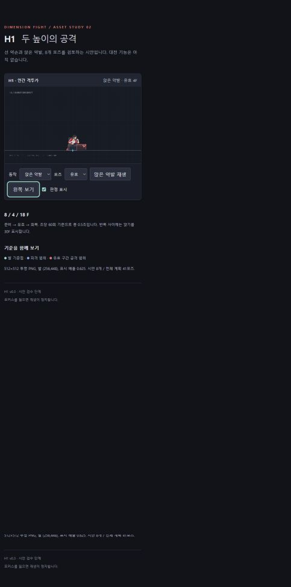

# H1 v2 · 접지 보완과 앉은 약발 검수

2026-09-30. 상태: **고유8/41포즈 시안, 완성 스프라이트·플레이 검증 전**. 미리보기는 v2를 사용하며 v1과 기준 이미지를 보존한다. 전투 규칙은 v0.3 그대로다.

## 제작과 채택
- 내장 ImageGen으로 선 약손3장을 대기 원화에서 팔만 변경하도록 재생성했다. 대기 원화는 v1과 바이트 단위로 같다.
- 앉기1장·앉은 약발3장을 만들었다. 유효 첫 후보는 지지 발/상체 이동, 회복 첫 후보는 발 회수 부족으로 제외하고 각각 한 번 수정했다. 제외 후보도 `*-rejected.png`에 보존했다.
- 현재 원화는 [generated/v2](../../assets/characters/h1/generated/v2/prompts.json), 정렬 결과와 변환값은 [derived/v2 manifest](../../assets/characters/h1/derived/v2/manifest.json)에 있다. 프롬프트에는 입력 역할·제약·재시도와 보류 이유를 기록했다.
- 원화는 모두1254×1254. 대기 기준 공통 축소384/1120을 선/앉은 자세에 똑같이 적용한다. 출력512×512, 가상 원점(256,448), 표시 배율0.625. 앉은 자세의 키를384로 늘리지 않았다.

## 측정
알파8 이상을 윤곽으로 보고 두 마스크의 교집합/합집합 비율(IoU)을 측정했다. 정렬 결과의 선 자세는 y400~447 전체, 앉은 지지 발은 x100~229·y410~447을 비교한다. 이 수치는 색상/얼굴 일치율이나 애니메이션 품질 점수가 아니다.

| 비교 | v1 | v2 |
|---|---:|---:|
| 약손 준비 ↔ 대기 발 윤곽 | 86.04% | 96.81% |
| 약손 유효 ↔ 대기 발 윤곽 | 88.80% | 96.34% |
| 약손 회복 ↔ 대기 발 윤곽 | 85.78% | 97.64% |

앉기 대비 지지 발은 준비97.00%, 유효98.09%, 회복97.24%다. 완전히 같은 픽셀은 아니지만 이전 약손보다 접지 흔들림이 줄어든 근거로 삼았다.

## 검증
- `npm run verify:assets`: v1 4장과 v2 8장 크기·RGBA·해시·투명 여백·잘림·공통 배율·지면 기준점 통과. 선 정수리 오차 허용1px, 앉기는 낮아진 자세를 별도로 검사한다.
- `npm test`: 선 약손6/3/15F와 앉은 약발8/4/18F의 준비/유효/회복 시작·끝, 검수용30F 대기와 반복 경계 테스트2개 통과.
- `npm run build`: 타입 검사·정적 빌드 통과. Phaser를 포함한 JS 약1.38MB로 기존 청크 크기 경고는 유지된다. 성능 검증은 아니다.
- Codex 내장 브라우저에서 동작 전환, 앉기/준비/유효/회복 선택, 재생, 좌향 반전, 판정 표시/숨김, 재생 중 동작 변경 시 정지·기본 자세 복귀를 확인했다. 하단 전환 시8/4/18F·0.5초 표기가 반영되고 선 자세로 돌아오면6/3/15F·0.4초가 복원된다. 확인 시 warn/error 로그 없음.
- v1 원화/정렬 결과, 기준 이미지3장과 SDD는 이전 커밋 대비 변경 없음.

## 시각 검수와 한계
- 외형·색상·머리 크기는 유지된다. 약손의 반대쪽 가드 손은 가슴 위치에 유지하도록 보완했다. 앉은 약발의 지지 발과 상체도 수정 후보에서 유지된다.
- 앉기 정렬 높이는 약239이미지픽셀, 표시 약149논리픽셀이다. 피격 높이120보다 머리 부분이 약29픽셀 높다. 선 자세에도 그림과 피격 범위 차이가 있으며, 사각형은 그림 전체가 아닌 명세 값이다. 이 관계의 실제 타격 적합성은 플레이에서 확인해야 한다.
- 유효 포즈의 주먹/신발은 해당 사각형과 겹친다. 약손 끝은 공격 끝보다 약12논리픽셀, 하단 발끝은 약5픽셀 더 나간다. 접지 개선만으로 최종 판정 정합성을 승인하지 않으며 수치는 임의 변경하지 않았다.
- 신발의 작은 윤곽 차이, 동작 전환의 자연스러움, 실제 피해/방어/AI/승패, 독립 Chrome·Edge 버전별 동작, 포커스 상실·로딩 실패 경로는 미검증이다.
- 다음은 대기 나머지1장·걷기4장·점프3장과 입력/이동 구현 준비다. 다른 공격·피격·KO를 포함해 아직33포즈가 남았다.

## 트러블슈팅 로컬 초안
### (정형수치문제) 프레임별 접지와 회수 거리 불일치
생성 지시만으로 동일 발 위치나 회수 거리가 보장되지 않았다. 시각 검수에서 지지 발 이동/발 회수 부족 후보를 제외하고, 변경 대상을 공격하는 팔/다리로 한정해 재생성했다. 동일 배율·지면 정렬 후 윤곽 겹침률을 별도로 측정했다. 이후 사용자 지정 위치의 [Notion 기록](https://app.notion.com/p/3eba2fe05e6881a4b540de7063630911)에 반영하고 재조회했다. 이 로컬 기록도 보존한다.
