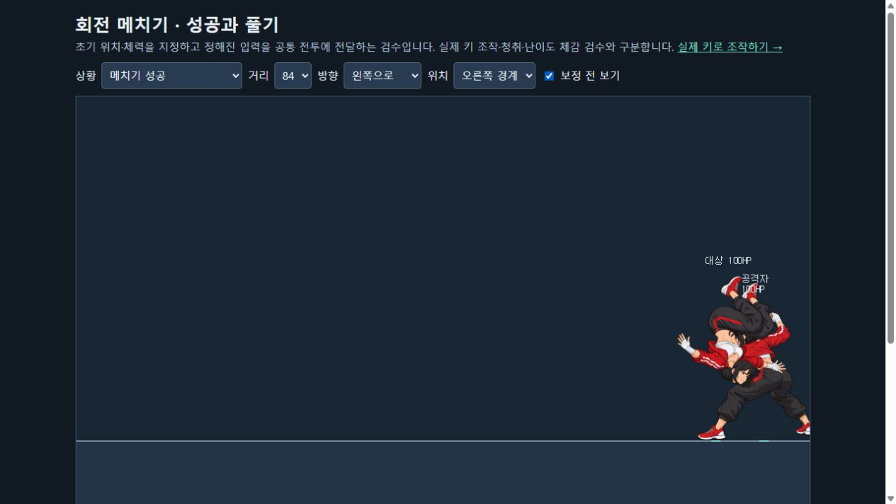
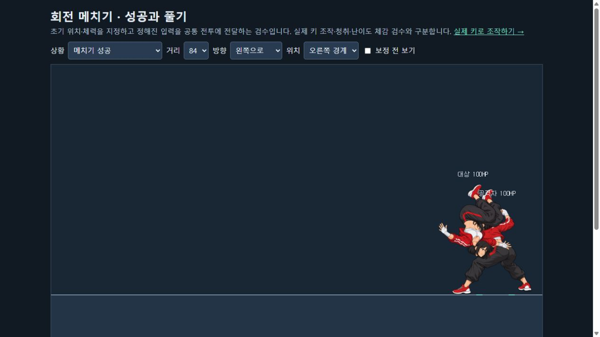

# H1 대기·방어·잡기 코너 표시 검수

2026-10-03 · [명세](../specs/h1-grab-edge.md) · 변경 전 `8ab001c`. 사용자 “현재 대전 체감·화면 보완” 선택을 이어 남은 정지·잡기 자세의 경계를 검수한다.

## 변경 전 측정과 설계

512×512 RGBA의 모든 alpha>0 픽셀 셀을0.625 배율·좌우 반전·실제 회전에 투영했다. 초기 위치만 지정하고 공통 입력으로 대기/방어/잡기·풀기·실패를 만들었다. 이전 피격·KO 측정 파일을 덮어쓰지 않고 별도 측정을 수행했다.

| 범위 | 변경 전 관측된 최대 수평 잘림 | 처리 |
|---|---:|---|
| 대기2·앉기1 | 14.375px | 대기2 합집합 [105,414), 앉기는 기존에도 잘림0 |
| 선/앉은 방어 | 35px | 현재 포즈의 최소 보정 |
| 현재 선택되는 잡기19포즈 | 40.625px | 같은 성공/풀기 잠금은 쌍 공통 보정, 그 외 개별 |
| 걷기12 | 35.625px | 이번 변경 제외 |
| 점프3 | 33.75px | 이번 변경 제외 |

위 값은 이 배치의 관측 최대이며 모든 가능한 기본기/상태의 최대값이 아니다. 잡기 이력 에셋25개 중 기존 밀치기6개는 현재 선택되지 않는다. 회전 포즈3개의 알파 셀 볼록 껍질은25/17/23점이며 전체9,724표시 상태(회전1,008)에서 실제 점유 행의 투영과 일치했다. GPU 필터링의 반투명 가장자리 확장이나 사람의 대전 체감까지 측정한 것은 아니다.

H0~12의48개 배치(좌우·방향·거리72/84/96·선/앉기·공격자0/1)에서 각각 보정하면 표시 중심 간격이 최대31.875px 줄었다. 거리72의 예는40.125가 된다. 공통dx는 원래72를 유지했다. 회전 사각형의 투명 모서리를 계산하면 실제로 잘리지 않는 선 붙잡힘H19도34.603px 이동하므로 실제 알파 셀 경계를 사용했다.

## 구현

`combatVisuals`가 보정 전 두 연출을 계산한 뒤 같은 성공/풀기 관계일 때 하나의dx를 적용한다. `grabPair`만으로 판정하지 않아 H54 공격자 복귀 뒤에는 독립 표시가 되고, 종료 스냅샷에는 결합을 보존한다. 기존136~1144 대상 고정 보정/복귀 보간은 제거했다. 회전·높이·시간표·논리 루트는 유지한다.

대기 두 프레임의 보정량을 같게 해 주기 안에서 표시 루트가 흔들리지 않게 했다. 다른 동작으로 전환할 때는 보정량이 달라질 수 있다. 일반 피격/KO의 기존 정확한 알파 경계와 KO 나이 전달을 유지한다. PNG·전투/입력·AI·음원은 변경하지 않았다.

원화 메타데이터는 `node --experimental-strip-types scripts/generate-h1-visual-bounds.mjs`로 실제 PNG에서 재생성한다. 런타임에는 디코더를 넣지 않는다. 자동 검사는 생성기와 별도로 실제 픽셀 셀을 읽어 표시 결과를 검증한다.

## 확인 결과

- 전체295/295(기존288+신규7)·TypeScript·Vite 빌드 통과. 기존 Phaser 청크 크기 경고는 남는다. 메타데이터 재생성 `--check`도 통과했다. 신규7개는 구현 전6실패/1통과였으며 API 부재뿐 아니라 실제 PNG 경계/공통 이동 누락을 확인했다. 마지막 테스트 정리 이후 관련31/31도 재확인했다.
- 양 코너·두 방향·거리72/84/96·선/앉은 대상의 H0~72, H0/H12/늦은H13·동시 잡기/실패, 관계ID/나이/종류/스냅샷 불일치, H54 새 행동/H72 이후 재잡기, 정지·시간 종료·KO, 대기 루트·방어·범위 밖 기본8공격과 전투 상태 불변을 검사했다. 기존 manifest의 alpha≥8 검사는 유지했고 회전 사각형의 투명 모서리 기대만 실제 alpha-cell 투영으로 대체했다.
- 독립 구현 검토에서 추가 수정할 결함을 찾지 못했다. 검수 HTML의96조합은 Node DOM 대역으로 입력·프레임 유지·경로·상태 불변을 검사했으며 실제 브라우저 픽셀 검사로 세지 않는다.
- 내장 브라우저의 연결 검수에서 오른쪽 코너 H24 전/후를 저장했다. 공격자는 표시x1200→1161.250, 대상은1136.946→1098.196으로 양쪽이38.75px 함께 이동하며 표시 간격63.054는 같다. 이는 H24 원래 공중 연출 간격이며 논리 간격84와 구분한다. 붙잡음H0은 양쪽15.625px 이동/표시 간격84 유지였다.
- 브라우저에서 오른쪽 H53→54의 공통/독립 표시, 왼쪽 H71→72 복귀, 대기 F0/F15의 동일 표시x94.375, H12 풀기 이후 간격100 유지, 메치기 KO의 다운 스냅샷과 중앙 H24 무보정을 확인했다. 이미지 로딩 완료 후 화면을 저장했다. 검수 도구에는 초기 방향 정렬용 공통 중립1틱을 추가했으며 표시F7=H0 등 기존 버튼 시간은 같다.
- 빌드4174의 경기/표적 화면은 이미지 로딩 후 시작·Esc 정지와 경고/오류0을 확인했다. 실제 키로 코너까지 이동해 메치기를 만든 검수는 아니다. 개발 비교 탭에는 편집 중 잠시 없었던 export/잔여 TS 구문 오류가 기록됐지만 수정·최종 새로고침 뒤 비교 조작은 정상 동작했다.

| 보정 전 | 보정 후 |
|---|---|
|  |  |

## 남은 범위

걷기·점프·기본 공격의 코너 표시와 동작 사이 발 정렬은 별도 후속이다. 실제 키로 코너까지 이동한 대전, 사람의 난이도·모션 자연스러움·청취, 독립 Chrome/Edge는 이번 자동 검수로 통과했다고 보지 않는다. [연결 검수 화면](evidence/h1-throw-review.html)은 초기 위치를 지정한 공통 입력 재현이며 사람 조작과 구분한다.
