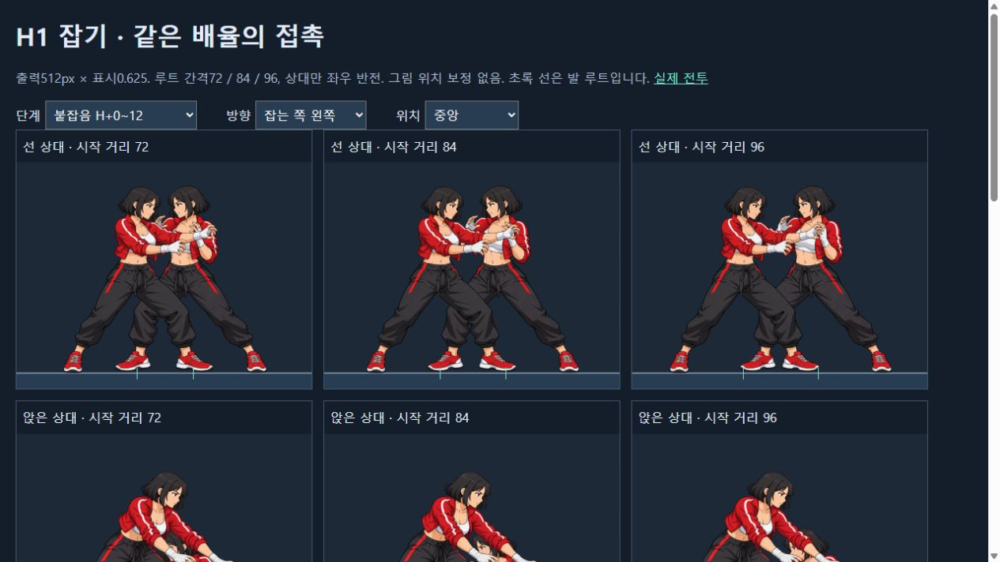
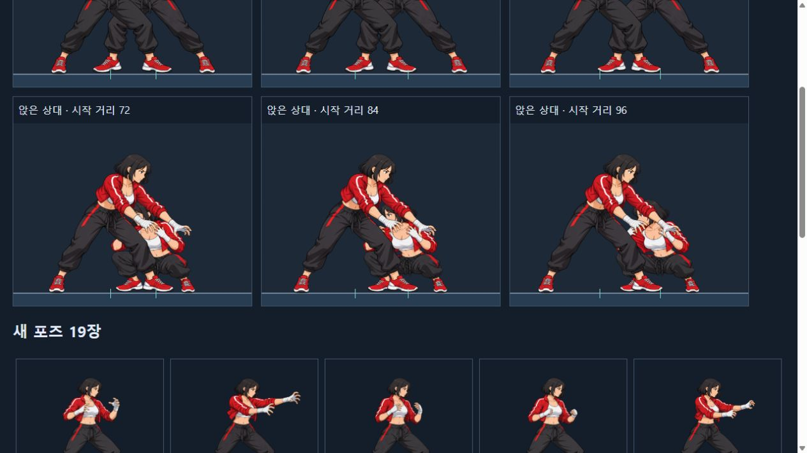

# H1 잡기·풀기 구현 검수

2026-10-03 · 사용자 “이 안으로 G 구현” 승인에 따라 [G 명세](../specs/h1-grab.md)를 구현했다. C 완료 커밋 `f05a2ad`에서 시작했으며 S 효과음·CPU의 잡기/풀기 선택은 추가하지 않았다.

## 구현

- U/I의 순서 있는 누름·놓기, 3F 겹침 조합과 최대50ms 단독 손 대기. 빠른 단독 탭/CPU 기본기 펄스는 놓는 즉시 시작한다. C 후속 입력은 추가 지연 없이 실제 공격 나이를 사용한다.
- 거리96·준비6/유효2/헛회복24F. 성공 H+1~12 새 U+I로 풀기, H+18 피해18·밀기48, 대상 H+30/공격자 H+36 독립 해제. 풀기는 양쪽16 분리·12F 복귀다.
- 일반 타격 우선·동시 잡기 상쇄, 정지 시 입력만 정리, 종료 시 실행 상태 제거와 렌더 포즈 보존. CPU는 잡기 잠금 중 유지 입력을 지우고 기존12F 판단 시계/순환 위치 계약을 지킨다.
- 표적 화면에 ‘표적 잡기 1회’와 ‘잡히면 1회 풀기’를 추가했다. 같은 공통 입력을 전달하며 체력/위치/성공 상태를 직접 바꾸지 않는다.

## 자동 검사

`npm test` **162개 통과**, `npm run build`(타입 포함), `npm run verify:assets` 통과. 기존 Phaser 청크 크기 경고는 유지한다. 신규 검사의 원본 코드 사전 실패는 확인하지 않았으므로 이를 주장하지 않는다.

입력 순서·겹침/비겹침·0/3/4F·놓기·유지/반복·발 우선순위·W/S·C 회귀, 거리72/96/97·양쪽/코너·방어/공중/경직 마지막F·일반 타격·동시 잡기를 검사했다. 풀기 H+1/12/13, 피해 H+17/18/19 단1회, 독립 H+30/36·풀기 T+12, 먼저 자유로워진 대상의 새 공격, 정지/시간/KO/초기화와 종료 포즈도 포함한다.

독립 코드 검토에서 두 경계를 고쳤다. 대기 U를 놓으며 I+J가 들어온 경우 실패한 새 I를 제외하고 대기 U와 J만 비교한다. 잡기 정의가 없는 대상도 공격자 정의의 풀기 창/복귀 기한으로 처리하도록 각 잠금에 소유자 기준 `releaseAt`을 저장한다. 영구 회귀 검사를 추가했다.

CPU 새 잠금 회귀2개는 방향/앉기 즉시 초기화·잠금 중12F 위상 유지·커서 고정과 해제 다음 예정 판단을 확인한다. H29→30 갱신 직전 상태가 잠금이면 그 회차를 건너뛰는 것은 [기존 AI 관측 계약](../specs/h1-ai-match.md)에 따른다.

## 그림과 접촉판

내장 ImageGen으로 원화20장을 만들고19장을 채택했다. 확대된 앉은 충격 후보1장은 보존 후 같은 해부학적 크기로 재제작했다. 정확한 요청은 [프롬프트10개](../../assets/characters/h1/generated/grab-v1/prompts.json)와 [추가10개](../../assets/characters/h1/generated/grab-v1/prompts-extra.json), 공통 정렬·해시는 [manifest](../../assets/characters/h1/derived/grab-v1/manifest.json)에 있다. 스크립트는 신체를 그리지 않고 공통 축소/투명 배치만 수행했다.

512×512 RGBA·투명 여백·발 루트(256,448)·배율384/1120·표시0.625를 검사했다. 기존75개 런타임 포즈와 원본은 보존하고 총94개 고유 파일을 연결했다. 새 그림의 살아 있는 복귀/풀기는 KO 그림과 구분된다.

[접촉판](evidence/h1-grab-contact.html)은 개발 서버에서 연다. 중앙 거리72/84/96의 선/앉은 붙잡음, 반대 방향 밀기 준비, 왼쪽 경계 충격, 오른쪽 경계 풀기·앉은 복귀를 육안 관찰했다. 실제 배율과 루트를 사용하며 위치 보정이나 판정 거리 변경은 없다. 가까운 거리에서 전신/손이 겹치며 팔 레이어를 별도로 분리하지 않는 한계가 있다. 코너의 넓은 선 자세 신발 끝 일부는 기존 무대 경계 밖으로 나갈 수 있다. 접촉판은 정적 그림 검수이며 실제 대전 성공 증거로 사용하지 않는다.

## 실제 브라우저 확인과 한계

내장 브라우저 빌드 화면 `4174/combat.html`에서 실제 키/버튼만 사용했다. D 펄스로 PLAYER400→608 접근, 거리272에서 U+I → 잡기 시도 age2, 이후 피해 없이 자유 복귀를 확인했다. 다시 U+I 후 Esc로 age1 포즈/위치를 보존했고 [화면 증거](evidence/h1-grab-attempt.png)를 저장했다. 초기화는 F0·400/880·100/100·타격 기록 없음으로 복원했다. ‘표적 잡기 1회’는 F2에서 CPU 시도 age1이 됐으며 정지/초기화가 동작했다. 양쪽 화면94포즈 로딩·사용법, 경기 화면60초·0:0·100/100 준비 상태, 세 검수 탭 warn/error0을 확인했다.

이 도구는 키를 짧게 눌렀다 놓으며 지속 누름을 제공하지 않는다. 반복 접근에서 이동이 일부 프레임에만 반영되어 이번 브라우저에서 근접 잡기 성공·PLAYER 풀기·표적 자동 풀기를 재현하지 못했다. 해당 성공/피해/풀기 시간표의 근거는 위 자동 검사이며, 실제 성공 플레이로 보고하지 않는다. 게임 상태나 위치를 주입하지 않았다.

사람의 단독 손50ms·콤보 전환/12F 풀기 난이도, 밀기1F와 회수의 자연스러움, 실제 근접 성공·풀기 및 독립 Chrome/Edge 플레이는 추가 검수 대상이다. 기존 앉은 방어 유지 제약은 CPU가 잡기를 선택하지 않으므로 남는다. S는 후속 상세 확인 대상이다.

### S 명세 전 추가 확인 · 2026-10-03

기존4174 탭의 이미지 실패 뒤 재시도에서 연결 거절을 확인했다. preview 서버를 다시 실행하고 새 검수 탭에서94포즈 준비·전투 시작을 확인했다. 시작 후 D 짧은 탭24회와 Esc를 전달했으나 정지F105에서 PLAYER400/CPU880으로 이동이 반영되지 않았다. 지속 누름 API가 없어 근접 잡기·풀기는 여전히 미확인이다. 위치/전투 상태 주입이나 게임 입력 변경은 하지 않았다.

검수 초기화 후F0·100/100·400/880·타격 기록 없음으로 복원했고 새 탭 warn/error0을 확인했다. [복구 화면](evidence/h1-sound-preflight.png)은 준비 상태 증거이며 근접 성공이나 S 오디오 검증 증거가 아니다. [S 상세안](../specs/h1-sound.md)은 별도 확인 대기다.
