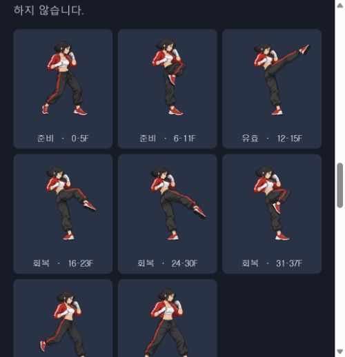
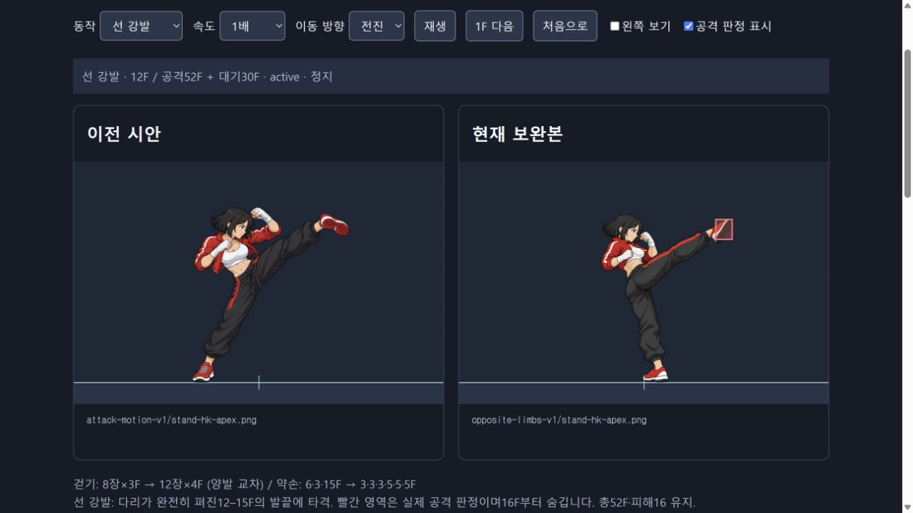

# H1 선 강발 첫 발차기 타격 검증 · 2026-10-02

최신 후속 수정: 시간뿐 아니라 완전히 뻗은 발끝으로 판정 위치를 보정했다. 아래 첫 검증은 시간 수정 당시 기록이며, 현재 결과는 마지막 **발끝 공간 정합성 재검수** 절을 따른다.

## 원인과 수정

사용자 검수에서 첫 발 뻗기와 타격 시점의 불일치가 발견됐다. 기존 첫 발 뻗기 `apex`는 준비12~17F, 내려온 `active` 그림은 유효24~27F로 지정돼 있었다. [수정 명세](../specs/h1-heavy-kick-contact.md)에 따라 선 강발 준비12/유효4/회복36F와 `apex` 유효12~15F로 맞췄다.16F부터 하강·회복이며 피해16·총52F·판정 범위·중단 방어 종류는 유지한다.

## 검증 결과

- 수정 전 새 회귀 검사2개 실패를 확인했다.12F의 체력은100으로 기대84와 달랐으며, 유효 구간을 헛친 뒤16F에 접근한 표적이24F에 맞았다.
- 수정 후 총62개 테스트 통과. 좌/우에서 실제 입력으로 시작한 강발의12F 첫 피해16·유효 포즈 apex, 단타 중복 피해 없음, 52F 종료를 검증했다. 처음4F를 헛친 뒤16F 또는24F에 접근한 표적에는 피해가 없었다.
- 전체 공격의 준비·유효·회복 경계와 방어 높이, 판정 거리·좌우 반전·코너·중복 피해·KO 정지·초기화 회귀도 통과했다.
- 에셋 검사·타입 검사·빌드 통과.75개 런타임 포즈와 모든 기존 PNG/해시는 유지한다. 기존 Phaser 번들 크기 경고는 남는다.
- 내장 브라우저 비교 화면에서11F lift/startup,12F apex/active,16F descend/recovery,24F 기존 active 파일/recovery를 확인했다. 약/강 유효 그림 비교도 구간 데이터에서 apex를 선택하도록 수정했다.16F 좌우 반전과 전체8장 구간표를 확인했고 비교 탭 warn/error는 없었다.
- 전투 화면에서 로딩·시작·K 입력 후 선 강발7F startup과 정지는 확인했다. 이후 이동 입력 검수는F0에 머물러 브라우저에서 표적 명중을 확인한 것으로 기록하지 않는다. 타격 시점·피해에 관한 성공 근거는 실제 공통 입력을 사용한 자동 테스트다.

## 화면 증거

- [12F active 상태](evidence/h1-heavy-kick-contact-12f.png)
- [12F 첫 발 뻗기 그림](evidence/h1-heavy-kick-contact-pose.png)
- [유효12~15F와 하강 회복 구간표](evidence/h1-heavy-kick-contact-strip.png)

## 남은 범위

이번 수정은 첫 발차기와 피해 발생 시간의 동기화다. 모션의 높이/지지발·KO 경계 잘림, 판정 사각형과 그림의 세부 공간 정합성, 준비12F/회복36F의 최종 밸런스·독립 Chrome/Edge 실제 대전 검증은 완료로 간주하지 않는다. 경기·AI·콤보·잡기·효과음 상세 구현을 추가하지 않았다.

## 발끝 공간 정합성 재검수 · 후속 요청

사용자는 다리가 다 펴지는 순간 발끝에서 타격하도록 재수정을 요청했다. 기존 사각형 x36~154/y-155~-65는 타격 그림의 발끝보다 아래였다. `stand-hk-apex`를 직접 확인해 신발 앞부분 x416~456/y80~128을 지정하고 루트(256,448)·배율0.625로 환산한 **x100~125/y-230~-200**을 공격 데이터에 반영했다. 포즈와12~15F 타격·총52F·피해16은 유지했다.

- 새 회귀 테스트2개는 수정 전 실패했다. 신발 내부 픽셀(444,96)의 작은 표적은 맞지 않았고, 중심 거리161의 상대는 기존 넓은 판정에 맞았다.
- 수정 후 **64개 테스트 통과**. 좌/우 각각 신발 내부2지점 접촉, 신발 아래/허리/기존 사거리 외곽3지점 비접촉,161경계 미타격·160거리1픽셀 겹침 타격, 선 방어·앉아 비접촉,12~15F 타격/단타/하강 미타격을 검증했다. 작은 표적은 검사 전용 캐릭터 데이터이며 실제 H1 피격 범위는 변경하지 않았다.
- 에셋 검사·타입 검사·빌드 통과.75런타임 포즈와 기존 PNG는 그대로다. 기존 Phaser 청크 크기 경고는 남는다.
- 내장 브라우저 비교 화면에서11F 판정 숨김,12F 완전히 뻗은 신발 앞부분과 빨간 판정의 겹침, 좌우 반전,16F 하강에서 판정 숨김을 확인했다. 표시 데이터는 전투와 같은 `H1.attacks` 및 `worldRect`를 사용한다. warn/error 로그0. 새 실제 대전 명중 검수는 수행하지 않았으며 피해 결과는 공통 전투 함수의 자동 테스트 근거다.
- 공간 보정에 따라 선 상대 사거리 경계190→161, 앉은 상대 비접촉으로 바뀐다. 중단 방어 분류 자체는 유지하지만 비접촉이 우선한다. 미구현 AI의 이전 강발 거리 선택과 앉은 방어 공략 설명을 폐기하고 재검토 항목으로 표시했다.
- 남은 범위: 다른 공격의 공간 정합성·전체 모션 체감·독립 Chrome/Edge 실제 대전과 밸런스. 경기·콤보·잡기·효과음 상세 승인 대기는 유지한다.

[오른쪽 발끝12F](evidence/h1-heavy-kick-toe-right.png) · [왼쪽 발끝12F](evidence/h1-heavy-kick-toe-left.png)

