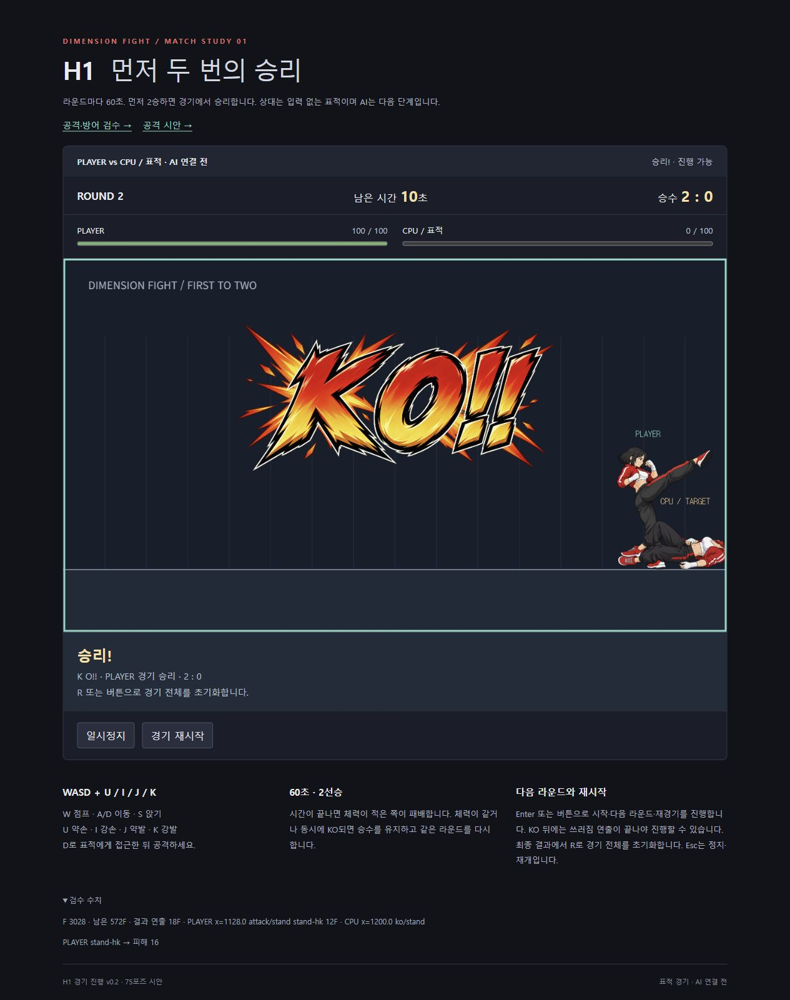

# H1 경기 진행 v0.2 검수 · 2026-10-02

## 구현과 승인

사용자가 “경기 진행부터 이 명세로 구현”을 선택해 [명세](../specs/h1-match-flow.md)의 P1~P4와 세부 흐름을 승인했다. 별도 `match.html`에60초·2선승·재경기·결과·초기화를 연결했다. 전투/포즈·75개 에셋·A KO 이미지를 재사용하며 상대는 입력 없는 표적이다. AI·콤보·잡기·소리는 구현하지 않았다.

`CombatState.ended`는 체력0에만 설정되므로 시간 종료를 이 값만으로 제어하면 전투가 계속될 수 있다. 경기 단계가 모든 종료 이유에서 전투 호출을 차단하고 KO 연출18F만 별도로 갱신한다. 라운드 결과는1회만 승수에 반영한다. 다음 라운드/재경기에는 새 전투 상태를 만들고 입력·시간·기록을 비운다.

## 자동 검증

- 기존64개와 경기12개·입력2개를 합쳐 **78개 모두 통과**했다.
- 3600F 라운드와60/59/1/0초 경계, HP70:40/40:70 시간 승리, 마지막1F 타격 후 체력 비교, KO 우선·동시 KO를 검증했다.
- 동률·동시 KO 재경기 각각4회 후 승패, 양쪽 각각2:0/2:1, 승수 중복 방지, 종료 후 공격·이동·시계 고정, KO0/5/6/11/12/17/18F와 조기 전환 차단을 검증했다.
- 공격/공중/결과 중 정지, 다음 라운드·재경기·전체 초기화, 유지 중 Enter/Esc/R과 전투 키가 새 상태에 누출되지 않는 조건,30/60/144Hz 결과 일치와 렌더 안의 종료 후 추가 전투 차단을 검증했다.
- 테스트 작성 중 초기화 검사의 fixture가 캐릭터 정의까지 복제해 참조 동일성 검사가1회 실패했다. fixture에서 전투 실행 상태만 복제하도록 수정했으며 런타임 초기화 구현을 우회하거나 기대값을 완화하지 않았다.
- 타입 검사·Vite 빌드·에셋 검사가 통과했다. 경기 진입점이 빌드에 포함되고75개 포즈와 원화/이전 버전 해시는 유지된다. 기존 Phaser 번들500kB 경고는 남는다.

## 실제 브라우저 검증

내장 브라우저에서 일반 버튼/키 입력만 사용했다. 경기 수치나 상태를 조작하는 검수 전용 우회 기능은 추가하지 않았다.

1. 로딩 후 준비 상태의 체력100/100·60초·0:0, 시작 버튼과 시간 진행을 확인했다.
2. Esc와 계속하기로 정지·재개했다. 게임 영역에서 검수 수치로 포커스를 옮기면 정지했다.
3. 실제3600전투F를 진행해100:100 동률·TIME UP·승수0:0·ROUND 1 재경기를 확인했다. 버튼으로 재경기하면 체력/위치/60초가 복원됐다.
4. D로 접근하고 K로 실제 피해16을 반복 적용했다. 첫 승패 라운드는100:36의 시간 종료로 PLAYER만1승, ROUND 1 결과를 유지했다.
5. Enter로 ROUND 2를 시작했다. 강발7회 명중으로 CPU체력0, A `K O!!`,18F 쓰러짐 후 `승리!`·2:0·경기 재시작 버튼을 확인했다. 다음 라운드 버튼은 없었다.
6. 종료 후 D/K에 위치·체력·공격 나이·승수는 그대로였다. 결과에서 Esc로 정지하면 재시작이 비활성화되고 Enter는 재개만 했다. 새 R로 ROUND 1 준비·체력100/100·60초·승수0:0·F0·시작 위치·타격 기록 없음이 복원됐다.
7. 기존 `combat.html`도 공유 에셋 로딩 후 시작·U 공격10F와 회복 표시가 정상이며 검사한 warn/error 로그는0이었다. 기존 이동 화면도 준비 상태로 로딩됐다. 경기 탭의 검사 시점 warn/error도0이다.

## 증거와 미확인 범위

- [동률 TIME UP·같은 라운드 재경기](evidence/h1-match-timeout-tie.png)
- [시간 종료 체력 우세·1승](evidence/h1-match-timeout-win.png)
- [ROUND 2 KO·최종2:0](evidence/h1-match-final-ko.png)
- [R로 전체 초기화](evidence/h1-match-reset.png)

CPU 승리·2:1·동시 KO·KO18F 직전 입력·반복 초기화3회 등 경계 사례는 자동 테스트 근거이며 이번 브라우저 플레이로 전부 확인한 것은 아니다. 필수 이미지 실패/재시도와 실제 외부 창·탭 비활성 전환은 이번에 재현하지 않았다. 브라우저에서 확인한 정지는 Esc와 게임 영역 포커스 상실이다. 독립 Chrome/Edge 실행·AI 대전·최종 밸런스/모션 품질은 후속이다. 기존 오른쪽 코너의 쓰러짐 그림 일부 잘림은 이번 범위 밖으로 남아 있다.
