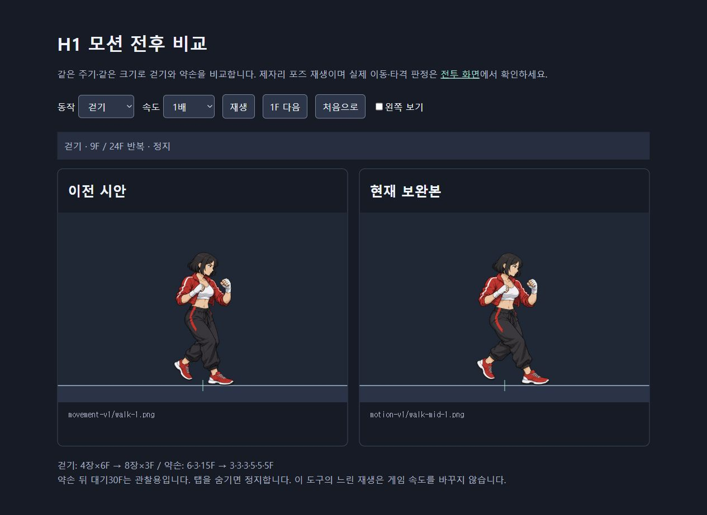
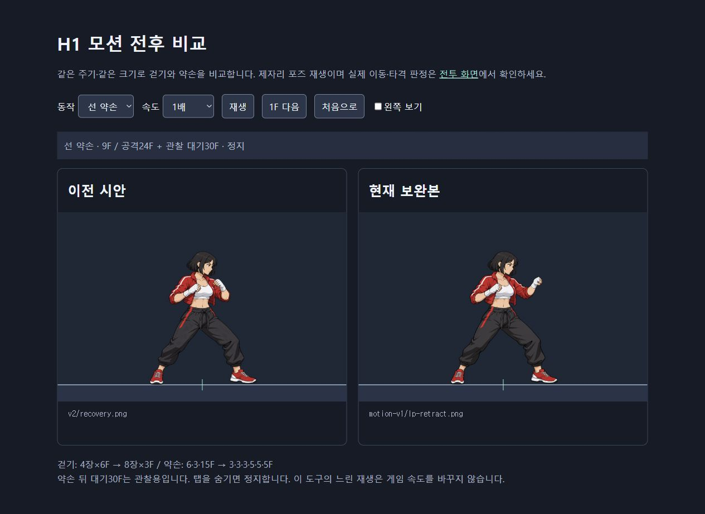

# H1 모션 재검수 · 2026-10-01

사용자 요청: 보완 후 움직임의 자연스러움을 테스트한다. 원본·전투 코드·전투 수치를 바꾸지 않고 이전/보완 포즈와 실제 전투를 구분해 검사한다.

## 검수 계획

- 별도 [포즈 비교 도구](evidence/h1-motion-comparison.html)에서 걷기4/8장, 선 약손3/6장을 같은24F 주기로 비교한다. 약손의 반복 사이 대기30F는 관찰용이며 실제 공격 길이에 포함하지 않는다.
- 실제 표시 배율0.625, 발 기준점(256,448), 같은 지면에서 비교한다. 기본 정지·1F 이동·0.25/0.5/1배 재생·좌우 반전으로 중간 포즈와 마지막→첫 포즈의 단절을 확인한다.
- 포즈 비교는 제자리 재생이다. 발 접지와 월드 이동의 관계·타격 거리·실제 입력 연결을 대신 검증하지 않는다.
- 전투 화면에서 이동 접근·공격·종료 후 대기 연결 및 기존의 연속 입력 처리 여부를 확인한다. 논리 테스트 결과와 체감 품질을 별도로 기록한다.
- 합격 기준: 발 기준점/몸 크기 유지, 의도하지 않은 순간이동·팔다리 겹침 없음, 준비→타격→회수→대기가 읽힘. 보조 수치가 통과해도 자연스러움을 자동 승인하지 않는다.

## 결과

검수 환경: Windows, Codex 내장 브라우저, 개발 서버. Chrome/Edge 독립 검수와 연속 키 유지의 실제 체감 검수는 별도다. 비교 도구는 개발 서버에서 열어야 하며 정적 배포 빌드에는 포함하지 않는다.

| 항목 | 실제 관찰 | 판정 |
|---|---|---|
| 걷기0/3/6/9F |3F의 중간 그림이6F의 발 모은 자세에 이미 가깝고9F도 비슷한 자세.0→3F에 보폭 변화가 집중됨 | 중간 그림 수는 늘었지만 보폭 분배 보완 필요 |
| 걷기23→0F | 마지막 중간 그림에서 첫 그림으로 정상 반복, 파일 누락 없음 | 주기 연결 동작 확인. 자연스러움 최종 승인 아님 |
| 약손3F | 이전 준비 자세 대신 팔을 일부 뻗는 그림 표시, 발 루트 유지 | 뻗기 중간 자세 추가 확인 |
| 약손9F | 이전에는 바로 회복 자세, 보완본은 팔을 거두는 그림 | 회수 단계 추가 확인 |
| 약손19→24F·좌향 | 대기 복귀 중간 그림→대기, 반전 시 동일 지면 루트 | 기본 연결 확인. 어깨/골반의 미세 변화와 실제 체감은 추가 확인 |
| 느린 재생·정지·1F 이동 |0.25배 재생에서 프레임 증가, 정지 후 각 버튼으로 프레임 선택/초기화 | 비교 도구 동작 확인 |
| 실제 전투 U 다음 I | D 펄스로 접근 후 U→I, PLAYER 약손 회복12F, CPU100→92. 이후 양쪽 대기·CPU92 유지 | 현재는 강손 연계가 발생하지 않음 |

순수 로직 재현: 중심 거리120에서1번째 갱신 약손,10번째 강손,20번째 약발 펄스를 넣었다.7번째 약손1회 피해8만 발생하고10/20번째는 기존 약손 상태 유지, CPU92였다. v0.3의 공격 중 입력 폐기와 일치한다. 이는 콤보 기능이 없는 현황 검증이며 새로운 콤보 실패 버그가 아니다.

`npm test`59개·`npm run verify:assets` 통과. 발 윤곽 겹침95.36/95.97/96.39%와 기준점 정렬은 유지된다. 비교 탭과 전투 탭의 warn/error 로그 없음. 게임 코드·기준 이미지·스프라이트 변경 없음. 빌드는 이번 문서/검수 도구 작업에서 재실행하지 않았다. 효과음은 아직 청취 검사할 구현이 없다.

결론: **모션 자연스러움 검수는 보완 필요**다. 약손의 중간 단계는 늘었지만 걷기는 원래 포즈에 가까운 중간 그림 때문에 보폭 변화가 고르지 않다. 다음 보완은 머리 높이만 맞추는 것을 넘어 발·무릎·골반의 중간 위치를 잡는 데 집중한다. 다른7공격·점프·쓰러짐 전체를 이번 검사로 통과 처리하지 않는다.
