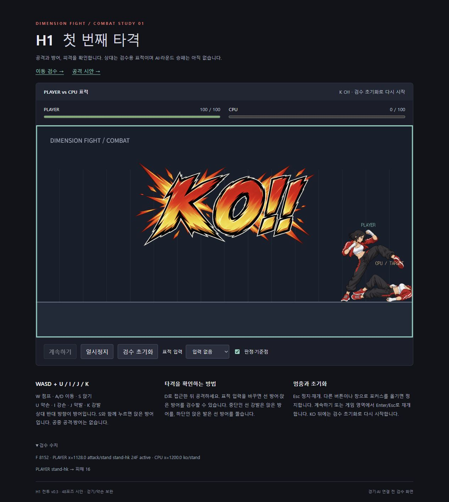
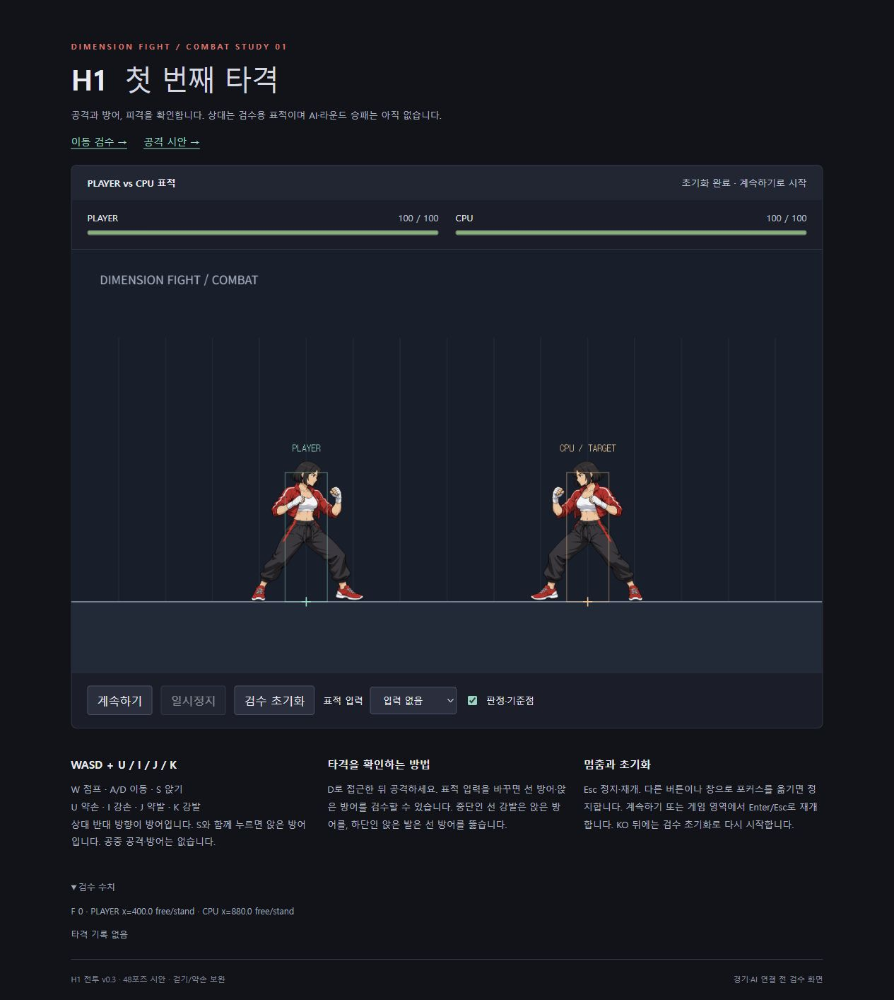

# H1 모션 보완·KO 표시 검수 · 2026-10-01

## 변경과 정합성

사용자가 전체 모션의 끊김을 지적하고 걷기·기본 공격부터 보완하도록 선택했다. 60Hz 갱신과 별개로 그림 수가 적고 준비/회복을 한 그림으로 오래 유지하는 것이 원인 중 하나다. [모션 명세](../specs/h1-motion-polish.md)를 먼저 작성하고 중간 그림7장을 추가했다. 기존 그림·기준 이미지·전투 수치는 보존했다.

- 걷기: 4장×6F → 8장×3F, 주기24F·속도240 유지.
- 선 약손: 3장 → 6장, 각3/3/3/5/5/5F. 준비6F·유효3F·회복15F·피해8 유지.
- 사용자 선택 A안을 `K O!!` 중앙 표시로 연결했다. 체력0 종료 때만 표시하며 초기화 시 숨긴다. 경기 진행·AI는 아직 연결 전이다.
- 전투 검수 화면에48개 고유 포즈를 사용한다. 기존 이동/공격 시안 페이지는 비교용으로 이전 배분을 유지한다.

## 실제 검증

- `npm test`: 59개 통과. 걷기8구간의24F 반복, 약손6그림과 판정 구간, 이전 전투·입력·이동 회귀 포함.
- `npm run verify:assets`: 원본/출력 해시·512×512 RGBA·투명 경계·(256,448) 정렬 통과. 새로운 그림의 상단은63~67, 발 하단447이다. 걷기 원화의 작은 상하 변화는 기존 이동과 같은±5 범위에서 확인한다.
- 추가 약손3장의 대기 대비 발 윤곽 겹침: 95.36% / 95.97% / 96.39%. 외형 승인 수치가 아니라 접지 안정성의 보조 측정이다.
- KO A: 1774×887, 투명 픽셀800,778개, 가장자리 알파 전부0. B는 가장자리26픽셀의 알파1 잔여가 있으며 선택되지 않은 원화로 보존했다. C 가장자리 알파0. 세 원화/프롬프트/해시를 보존했다.
- `npm run build`: 타입 검사·정적 빌드 통과. 기존 Phaser 청크500kB 초과 경고 유지.
- 내장 브라우저: D 접근 후 U로 CPU100→92, 피해8 확인. 강발 타격을 이어 CPU0에서 A 이미지가 중앙에 표시되고 캐릭터 앞을 가리지 않는 배치 확인.
- KO F8152, PLAYER x1128/HP100, CPU x1200/HP0. U/D 입력 후에도 동일 프레임·위치·체력을 유지했다. Esc 정지 중에도 KO 그림 유지.
- 검수 초기화 후 F0, 위치400/880, 체력100/100, 타격 기록 없음으로 복원되고 KO 그림 제거. 검사 탭 warn/error 없음.

## 남은 검수와 보완

중간 그림 수 증가와 실제 부드러움의 최종 승인은 구분한다. 이번에는 걷기와 선 약손을 연결한 첫 보완본이며 사용자의 체감 확인이 필요하다. 다른7공격·점프·쓰러짐의 전체 모션은 보완 전이다. 선 발차기 지지발/상체 흔들림, 경계1200에서 쓰러짐 그림 일부가 화면 밖으로 잘리는 기존 문제도 남는다. 전체 대전·AI·경기/시간 종료 연출, Chrome/Edge 독립 검증은 수행하지 않았다.
