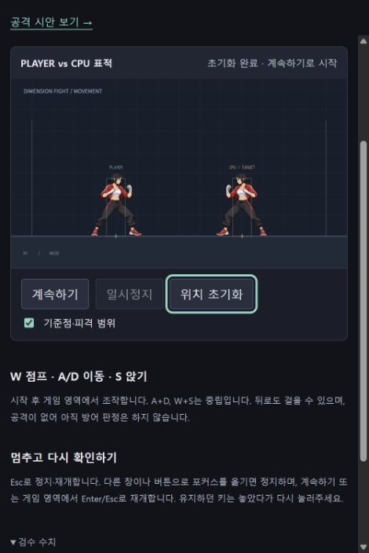

# H1 입력·이동 검수

2026-09-30. 상태: **이동 단계 구현, 고유16/41포즈 시안**. 전투 v0.3 수치를 유지했다. 공격·방어·피해·경기·AI는 아직 없으며 CPU는 접촉 확인용 입력 없는 표적이다.

## 제작과 구조

- [작업 명세](../specs/h1-movement.md)를 작성한 뒤 대기 추가1장·걷기4장·점프3장을 내장 ImageGen으로 제작했다. [정확한 프롬프트](../../assets/characters/h1/generated/movement-v1/prompts.json)와 원화를 보존한다.
- [정렬 manifest](../../assets/characters/h1/derived/movement-v1/manifest.json)에 해시·공통 배율·원화 기준점·출력 윤곽을 기록했다. 모든 원화1254×1254, 출력512×512 RGBA, 배율384/1120, 루트(256,448), 게임 표시0.625다.
- 지상 포즈는 신발 하단을 정렬한다. 점프는 대기 원화의 가상 지면1194를 고정하며 발끝을 다시 지면에 맞추지 않는다. 얼굴/의상/몸을 스크립트로 다시 그리거나 합성하지 않았다.
- 기존 공격 시안 페이지는 유지하고 `movement.html`을 추가했다. 입력·고정 시간·공통 이동을 Phaser와 분리했다. 이동 화면은 v2 대기/앉기2장과 새8장을 로드한다.

## 검증 결과

- `npm test`: 기존 타이밍2개와 입력/이동13개, 총15개 통과. 60F 이동240, 앉기 중 이동0, 점프 정점160·48F 착지, 이중 점프/예약 점프 없음, 착지 자세, 방향, 양쪽 코너·공중 최소 간격72를 검증했다.
- 30/60/144Hz 렌더 간격에 동일 방향 입력을 공급해 같은 결과를 확인했다. 과부하 최대5F, 누적시간 초기화, 반대 방향 상쇄, OS 반복 및 초기화 후 키 해제를 검증했다. 복잡한 전체 전투 입력 재생 검증은 아니다.
- `npm run verify:assets`: v1 4장·v2 8장·movement-v1 8장의 크기/RGBA/해시/투명 경계/공통 배율/기준점 검사 통과. 버전 중복 때문에 이20개 파일을 고유20포즈로 세지 않는다.
- `npm run build`: 타입 검사와 두 HTML 페이지 정적 빌드 통과. Phaser 공통 청크 약1.38MB로500kB 경고가 남아 있다. 성능 검증 결과는 아니다.
- Codex 내장 브라우저에서 이미지 로딩, 시작 버튼, D 이동(x400→404), A 이동(x404→396), W 점프(y486.9/상승 상태 관찰) 및 착지, Esc 정지, 정지 중 D 무시, Enter 재개, Tab으로 포커스가 벗어날 때 정지, 위치 초기화(F0/x400/y600/간격480)를 확인했다. 확인 시 warn/error 로그 없음.
- 기준 이미지3장·SDD·v1/v2 원화 및 파생 결과는 이전 커밋 대비 변경하지 않았다.

## 시각 검수와 미확인 사항

- 빨간 재킷·검은 단발·흰 상의·검은 바지·붕대·빨간 운동화의 외형을 유지했다. 대기/걷기 정수리 출력y63~66, 접지 하단447~448이다. 걷기 중 다리가 교차하는 포즈의 폭과 골반 위치 차이가 있으며 매끄러운 연결/발 미끄러짐 품질은 완성 승인 전이다.
- 점프 출력 하단은 상승413/정점377/하강453이다. 하강 발끝은 루트보다5이미지픽셀(표시 약3.1픽셀) 아래다. 마지막 공중 갱신의 루트는 지면보다 약13.1픽셀 위이고 착지 갱신에 지상 포즈로 바뀐다. 이 수치 관계와 착지의 자연스러움은 구분한다.
- S 유지·동시 유지 입력·장시간 걷기의 실제 키보드 체감, 창/탭 전환, 로딩 실패/재시도, 독립 Chrome·Edge 버전별 확인은 아직 하지 않았다. S/동시 입력 규칙은 단위 테스트만 통과했다.
- 상대와 접촉할 때 그림의 팔다리는 겹칠 수 있다. 최소 간격과 피격 사각형은 그림 전체 폭이 아니라 승인된 명세를 따른다. 실제 타격 적합성은 전투 단계에서 확인한다.
- 다음 제작량은 공격6종18장·방어/피격4장·쓰러짐3장, 총25장이다. B1/R3 적용과3명 선택은 H1 전투 흐름 이후다.

## 트러블슈팅

### (정형수치문제) 점프 포즈의 가상 발 기준점

원화의 점프 발끝 높이가1092/987/1208로 달라 지상용 하단 정렬을 그대로 쓰면 상체가 아래로 밀린다. 대기 가상 지면1194를 공통 적용하고 점프 전용 검사로 검증했다. 실제 장애를 재현한 기록이 아닌 제작 중 확인한 정렬 방식의 부적합이다. [Notion 기록](https://app.notion.com/p/3eba2fe05e688139a756e7be9c5bbc5b)에도 보존했다.
