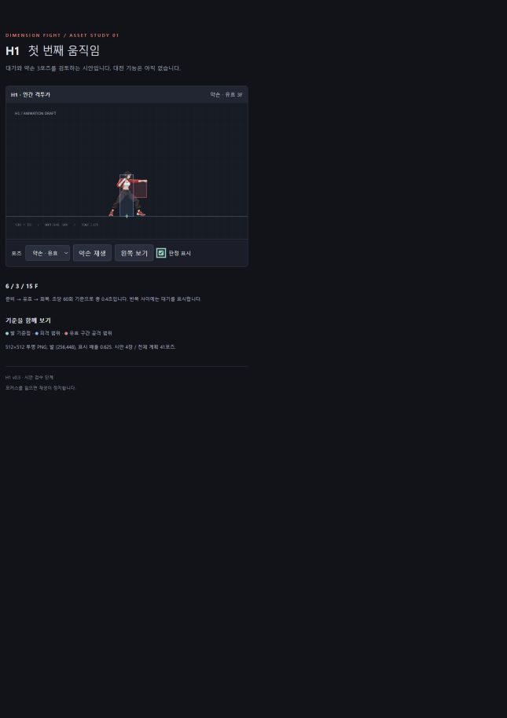

# H1 대기·약손 시안 검수 · 2026-09-30

상태: **4/41포즈 시안 준비. 완성 스프라이트 승인 전.** 대전·피해·AI·승패는 아직 구현하지 않았다.

이 문서는 v1 당시 기록이다. 이후 보완과 앉기/하단 시안은 [v2 검수 기록](h1-crouch-preview.md)을 참고한다.

## 산출물과 재현
- 생성 도구: ImageGen. 원본 H1을 외형 기준으로 사용했고 후속 프레임은 대기 또는 유효 원화도 참조했다. 정확한 프롬프트와 입력 관계는 [prompts.json](../../assets/characters/h1/generated/v1/prompts.json)에 있다.
- 생성 원화 4장은 1254×1254 RGBA로 반환됐다. 요청한 512×512와 달라 원화를 보존한 뒤 사용자가 승인한 스크립트 정렬을 수행했다.
- [정렬 스크립트](../../scripts/normalize-h1.ps1)는 Windows System.Drawing으로 비율 유지 축소와 투명 캔버스 배치만 수행한다. 얼굴·의상·포즈를 다시 그리지 않는다.
- 공통 배율은 대기 알파 높이 1120 기준 `384/1120`. 모든 프레임에 같은 배율을 사용한다. 원화 x=627을 가상 중심으로, 각 포즈의 발바닥 아래 경계를 y기준으로 잡아 출력 (256,448)에 배치한다.
- 출력 알파 경계는 네 장 모두 위64·아래447이다. 픽셀447의 아래 경계가 기준선448이므로 오프바이원 오류가 아니다. 발 기준점은 양발 사이의 가상 원점이며 특정 발가락 픽셀을 뜻하지 않는다.
- 출력·원화·기준 이미지의 SHA-256과 좌표 변환은 [manifest](../../assets/characters/h1/derived/v1/manifest.json)에 보존한다.

## 검증 결과
| 항목 | 실제 확인 결과 |
|---|---|
| 원본 보존 | main 병합 커밋 대비 기준 이미지 3장과 SDD 변경 없음 |
| 자동 이미지 검사 | 4장 모두 512×512 RGBA, 투명 배경·경계 잘림 없음, 공통 배율·기준점·파일 해시 통과 |
| 개발 환경 | Windows, Node 24.18.0, npm 11.16.0. Phaser 4.2.1 / TypeScript 7.0.2 / Vite 8.3.1 고정 |
| 타입·빌드 | `npm run build` 통과. Phaser 포함 JS 약1.38MB(압축 약359KB)로 Vite 크기 경고 있음. 실패는 아니며 성능 측정 전 분할 최적화는 하지 않음 |
| 브라우저 | Codex 내장 브라우저. 이미지 로딩, 4포즈 선택, 재생/정지, 좌우 반전, 판정 표시/숨김 확인. 버튼·체크박스는 키보드 Space로 확인 |
| 오류 로그 | 확인 시 브라우저 warn/error 로그 없음 |
| 전투 타이밍 | 검수 화면에 준비6F·유효3F·회복15F, 검수용 대기30F를 표시. 렌더 경과 시간 기반 미리보기이며 실제 60Hz 전투 검증은 아님 |

## 시각 판정과 남은 문제
- 검은 단발, 빨간/흰 재킷, 흰 상의, 검은 바지, 붕대, 빨간 운동화의 외형과 색상은 네 장에 유지된다.
- 기본 키와 발바닥 높이는 일치한다. 다만 신발 윤곽·발 간격과 가드하는 팔 위치가 포즈별로 조금 달라 전환 흔들림이 남는다. 정확한 발 접지 형태까지 고정된 완성 애니메이션으로 승인하지 않는다.
- 유효 포즈 주먹은 공격 사각형 윗부분과 겹친다. 끝부분이 사각형 끝보다 약6 논리 픽셀 돌출하는 시안이므로 실제 타격감과 접촉 거리 검증은 남겨 둔다. 승인된 전투 수치를 그림에 맞춰 임의 변경하지 않았다.
- 좌우 반전에서 가상 원점과 사각형은 대칭이다. 팔다리가 이미지 캔버스 밖으로 잘리지 않는다.
- 독립 Chrome·Edge의 버전별 검증, 탭 이탈/복귀·이미지 로딩 실패 경로, 전투 전체 검증 V01~V28은 미수행이다.
- 다음 단계는 대기·약손의 접지/팔 전환 보완과 앉기·앉은 약발의 낮은 판정 검수다. 나머지37포즈를 완성했다고 취급하지 않는다.

## 트러블슈팅 로컬 초안
### (정형수치문제) 생성 캔버스와 요청 규격 불일치
요청은512×512였으나 원화는1254×1254로 반환됐다. 출력 크기를 추정하지 않고 PNG 헤더·알파 경계를 확인했다. 공통 비율 유지 축소와 투명 배치 후 자동 검사로 확인했으며 원화는 그대로 보존했다. 이후 사용자가 기록 위치를 지정하여 [Notion 기록](https://app.notion.com/p/3eba2fe05e688143aec8e0b9602418a0)에 반영했다. 이 로컬 기록도 보존한다.
