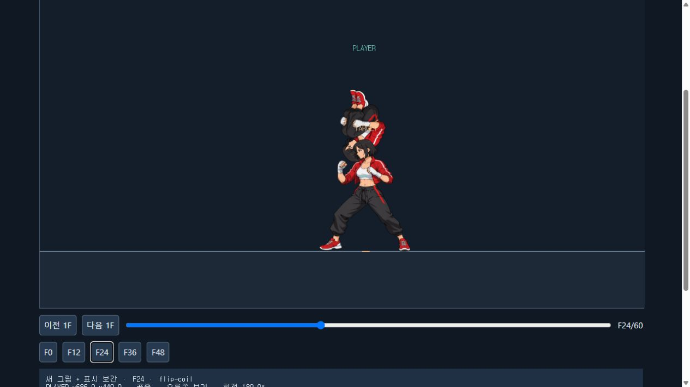

# H1 회전 점프·45장 중간 그림 검수

2026-10-03. 사용자 요청과 **W 제자리 / W+A/D 방향 점프·공중 상대 통과** 선택을 [명세](../specs/h1-smooth-flip.md)에 반영했다. 출발 기준은 main `7c66812`이다.

## 변경과 검수 범위

기존 공중 간격72의 몸 분리를 제거해 한쪽 이상 공중이면 통과한다. 둘 다 착지하면 현재 좌우 순서로 분리하고 즉시 돌아본다. 지상 통과 금지·경계80~1200·높이160·체공48F·이동240을 유지한다. 교차 틱의 타격 밀어내기 방향은 실제 접촉 직전 위치 스냅샷을 쓴다. 공중 피격은 회전을 중단하며 경직 종료 뒤에도 착지 전에는 회전하지 않는다.

내장 ImageGen으로 새45장을 제작했다. 회전7, 걷기 사이12, 대기 사이2, 공격8종의 준비/회복16, 피격/KO/잡기8이다. 기존100개 등록키를 보존해145개 고유 파일을 사용한다. 보행24장/48F와 대기4장/30F, 공격·잡기·KO의 새 그림 배분은 명세 표를 따른다. 유효 공격 그림·공격 구간·피해·C/G/AI/S2의 실제 사건 시점은 유지한다.

프레임 사이 위치/각도와 공통 카메라·가이드를 함께 보간한다. 판정과 공격 age는 현재 논리틱이며 타격·착지·방향 전환·잡기 관계·원점 변경·정지/종료에서는 과거 표시 이력을 버린다. 새 표시 지연은 최대1F이고 전투 틱이나 입력 처리 자체를 늦추지 않는다.

## 제작 중 발견과 조치

- 선 강발의 첫 준비 후보는 잘못된 다리, 앉은 강손 첫 준비 후보는 잘못된 팔이었다. 재생성해 빨간 줄 다리의 강발과 몸 앞을 가로지르는 가까운 강손을 선택했다. 일부 준비 후보는 이름과 달리 늦은 뻗기 자세여서 기존 extend 뒤에 배치했다.
- `flip-lift`의 극저알파 잔여가 45°에서 루트 여유194.454px까지 퍼졌다. 배경 정리 재생성2회는 체형 확대 또는 잔여 문제로 제외했다. 픽셀 삭제·카메라 축소 대신 초반 접기 일정을 F1~3 rise/F4~5 lift/F6~9 fold/F10~16 tuck으로 조정했다. 이륙 초반에 몸을 접고 실제 사용각도와 분수 렌더에서 기존M192를 지킨다. 전체48F·360°는 유지한다.
- 보행 중간 후보의 머리 상단59/70이 기존 선택12장의 관측범위62~68을 벗어나 세 장을 재제작했다. 최종14장의 상단은61~68로 기존 명세의64±5 허용기준을 지킨다. 새02의61은 기존 관측 최소보다1텍스처px(표시0.625px) 높다. 관측범위와 명세 허용기준을 구분하며, 포즈별 확대/축소로 맞추지 않았다. 선택/미선택 원화·정확한 프롬프트·SHA는 각 생성 폴더에 보존한다. 규격 검사를 자연스러움의 사용자 승인으로 대신하지 않는다.

## 증거와 재현

- [실제 Phaser 모션 비교](evidence/h1-smooth-review.html): 현재/이전 그림 간격, 제자리/양방향 점프, 보행/대기/공격8종, 재생·정지·1F 이동. 게임과 같은 `stepCombat`/`sampleCombatRender`/포즈/원화를 사용한다. 비교의 이동 판정은 현재 공통 규칙이므로 이전 충돌 코어를 재현하는 도구는 아니다.
- `npm test`, `npm run verify:assets`, `npm run build`로 자동 검증한다. `tests/h1-jump-crossing.test.mjs`는 교차·착지·접촉/AI, `h1-flip-visual.test.mjs`는 원화 알파·실제 회전·중단, `h1-render.test.mjs`는 보간 경계를 확인한다.
- 새 원화 묶음: [flip 프롬프트](../../assets/characters/h1/generated/flip-v1/prompts.json), [walk/idle 프롬프트](../../assets/characters/h1/generated/smooth-v1/prompts.json), [공격 준비](../../assets/characters/h1/generated/supplement-v1/prompts.json), [공격 회복](../../assets/characters/h1/generated/supplement-v1/recovery-prompts.json), [반응/잡기](../../assets/characters/h1/generated/reaction-smooth-v1/prompts.json). 선택 파일/변환/SHA는 같은 버전의 `derived/manifest.json`에 있다.

## 확인 결과

전체322/322(기존301 + 교차9 + 보간8 + 회전4), TypeScript 포함 Vite 빌드, 전체 원화/파생 해시·512 RGBA·알파 여백·기준점·고유 픽셀 검사를 통과했다. 새 교차 핵심8검사는 기존 코드에서7실패/1통과를 확인한 후 구현했고 최종9개로 보강했다. 회전 검사는 양쪽 끝/중앙·양 선수·제자리/방향·48틱·보간0/.25/.5/.75/1의4,800 샘플에 더해 실제 alpha>0 행끝의 연속 각도 내부 극점까지 검사한다. 사용된 flip-lift의 최대 루트 여유는191.983191px로 M192 안이다. 독립 소스 검토에 추가 결함은 없었으며 기존 Phaser 청크 크기 경고는 남는다.

내장 브라우저의 최종145/145 원화 로딩과 실제 Phaser 화면에서 F24 180°·x686/y440, F48 상대 뒤 x782/y600·왼쪽 보기, 반대 방향 x498/y600·오른쪽 보기, 제자리 x590 유지와 착지를 확인했다. 보행 재생F24→39·정지/이전 간격 비교, 선 강발F36와 앉은 강손F24의 새 회복 그림도 확인했다. 이는 초기 위치+공통 입력 재현이다.

빌드 combat.html에서는 실제 W 입력 뒤 F25의 회전 자세·Esc 정지와 초기화F0/400·880/100:100을 확인했다. 첫 같은 호출의 W+D/정지 시도는 방향 이동을 확인하지 못해 실제키로 상대를 넘었다고 보고하지 않는다. 양방향 통과의 브라우저 근거는 위 공통 입력 화면이다. movement.html에서도 실제 W 뒤 F25·x400/y467.8/vy-333.3·jump와 정지를 확인했다. AI 경기의 새 조작 안내·145포즈 로딩·시작·Esc 정지도 통과했다. 네 최종 탭 warn/error는0이며, 배경 탭의 벽시계 시간을 FPS 측정으로 사용하지 않았다.

[실제 W 입력 화면](evidence/h1-smooth-live-w.png) · [반대 방향 착지](evidence/h1-smooth-land-left.png)

실제 사용자의 자연스러움·난이도·입력 체감, 독립 Chrome/Edge와 귀 청취는 별도 확인 대상이다. 원화 수·규격·경계 검사를 사람의 최종 모션 승인으로 대신하지 않는다.
