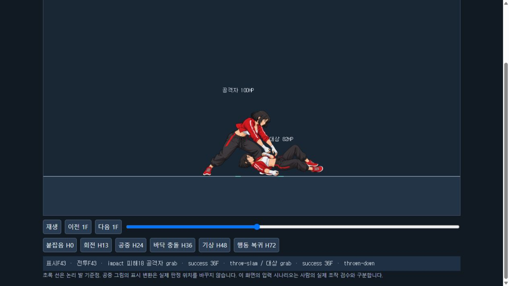
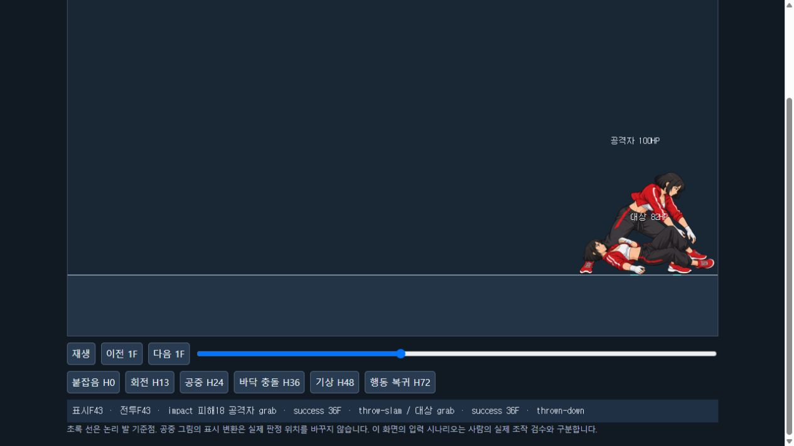
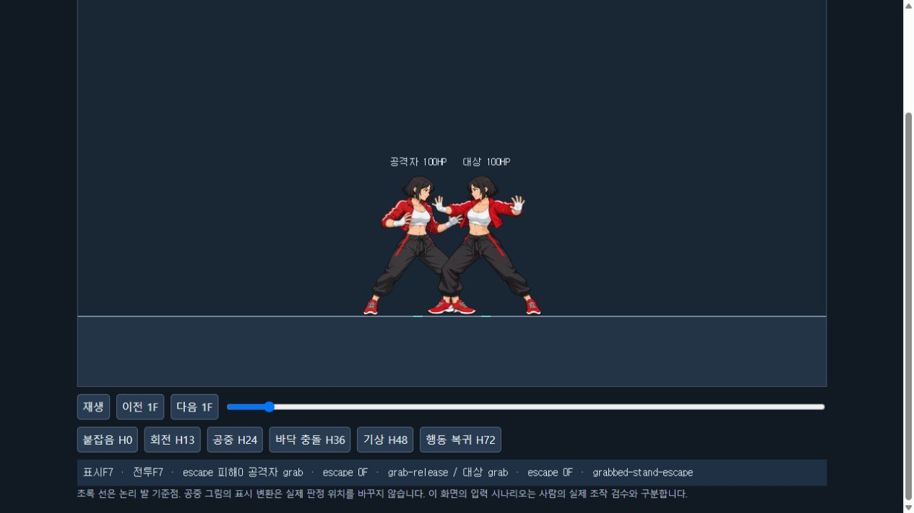

# H1 회전 메치기와 동시 입력 풀기 검수

2026-10-03 · 사용자 메치기 수정 요청과 “권장 시간표로 수정” 승인을 [수정 명세](../specs/h1-throw-revision.md)에 따라 반영했다. 시작 커밋은 `8d0e289`이며 효과음 제작은 진행하지 않았다.

## 구현과 수정 이유

이전 G는 상대를 잡고 지상에서48만큼 밀었으며 실제 회전·다운이 없었다. 이제 붙잡음 → 몸 돌리기 → 공중으로 넘김 → 바닥 충돌 → 다운 → 기상으로 표시한다. 거리96·피해18·손 조합3F·풀기 끝H12는 유지하고 사용자 승인대로 충돌H36/공격자복귀H54/대상기상H72로 변경했다. 대상은 충돌 이후 기상 완료 전까지 일반 타격·재잡기에 맞지 않는다.

H0에 대상의 새 U+I가 완성돼도 이전 코드는 대상의 새 잡기 준비로만 처리한 뒤 손 이력을 지웠다. 잡기 성립 직전에 해당 틱의 순서 있는 새 손 입력을 풀기 모드로 다시 판독해 피해0 풀기1건으로 처리한다. H0 새 한 손은 H1~3의 반대 손과 조합하며 H 이전 유지·OS반복·비겹침은 제외한다. 같은F 타격 우선과 양쪽 유효 잡기 상쇄는 유지한다.

잡기 소유자의 충돌 시점·풀기 끝·밀림 값을 양쪽 표시 상태에 보존한다. 독립 해제와 실행 관계 수명을 분리해 공격자H54 해제 뒤에도 대상의 다운 잠금을H72까지 유지한다. 메치기 KO는 바닥 자세를 유지하며 일반 타격 KO의 기존18F 그림 순서는 바꾸지 않았다. 정지/시간 종료는 마지막 포즈와 표시 위치를 고정한다.

## 자동 검사

최종 전체 `npm test` **174개 통과**, `npm run build`(타입 포함), `npm run verify:assets` 통과. 기존 Phaser 청크 크기 경고는 유지한다. H0 관련 선택 검사에서 수정 전 실패4건/통과2건을 확인한 뒤 구현했다. 전체 신규 검사 모두에 사전 실패를 실행한 것은 아니다.

- 잡기36개: H0 양손 순서/빠른 놓기/선·앉은/양쪽/거리·코너, H0 한 손→H1~3·H4, H 이전 유지/반복, H12/13·타격 우선·동시 잡기·시간 종료·정지·KO.
- 승인 시간표: H35/36 단1회 피해, H54 공격자 자유·H72 대상 자유, 다운 중 공격/재잡기 차단과 H72 정상 판정, 이전 관계 해제와 새 관계 성립.
- 포즈·AI:100개 경로, 각 그림 구간과 양쪽/반전, 메치기 KO·시간 종료 스냅샷, CPU12F 시계/입력·커서 보존과 해제 직전 상태 관찰.
- 표시4개: 전투 상태 불변·종료 표시 고정·좌우 대칭·실제 원화 경계의 양쪽 코너 포함, 대상 잡기 정의가 없거나 공격자 밀림이 다른 경우, 가능한 가장 짧은 충돌 시간표의 바닥 포즈.

독립 검토에서 대상 정의의 밀림값을 읽는 표시 오류와 짧은 유효 시간표의 충돌F가 붙잡음으로 남는 문제를 찾아 수정했다. 최종 읽기 검토에서 추가 결함은 발견하지 못했다.

## 이미지와 표시

내장 ImageGen으로 공격자 회전/들어 넘김/내려찍기3장, 대상 공중/바닥/기상3장을 제작했다. 바닥의 첫 후보가 팔꿈치로 상체를 받쳐 충돌 자세로 읽히지 않아 보완했고 탈락 원본도 보존했다. 총 원화7개 중6개 채택, 기존94포즈 보존, 런타임100개다.

[공격자 프롬프트](../../assets/characters/h1/generated/throw-v1/prompts-attacker.json)·[대상 프롬프트](../../assets/characters/h1/generated/throw-v1/prompts-target.json)에 참조/정확 요청/도구 출력/파일 해시를 기록했다. [정렬 manifest](../../assets/characters/h1/derived/throw-v1/manifest.json)의1254 원화→512 RGBA·공통384/1120 배율·발 루트(256,448)를 사용한다. 공중은 가상 지면, 바닥은 신체 최하단 기준이다. 정렬 스크립트는 신체를 다시 그리지 않는다.

공중 궤적/회전은 논리F 기반 표시 변환이다. 판정 루트·좌우 순서·피해를 바꾸지 않는다. 처음 코너 검수에서 누운 몸의 발이 잘려, 채택 원화의 표시 범위를 기준으로 공중/다운을 화면 안에 제한하고 기상 중 원래 루트로 돌아오게 했다. 바닥/기상 이름표 높이도 함께 조정했다. 두 사람이 같은 H1 외형이라 몸이 겹칠 때 팔을 분리해서 그리는 레이어는 아직 없으며 동작 자연스러움은 사용자 체감 검수 대상이다.

## 브라우저 확인

개발 서버4175의 [연결 검수 화면](evidence/h1-throw-review.html)에서 공통 전투를 정해진 입력으로 진행했다. 중앙 거리84의 H24 공중 자세·H36 피해18/바닥 접촉, 오른쪽 코너 수정 후 전신 표시, 왼쪽 코너 거리96의 앉은 대상 H48 기상, H0 풀기 피해0/양쪽 분리와 메치기 KO의 바닥 포즈를 확인했다. 이 화면은1F·재생·반전·거리·코너 선택을 제공하며 사람의 실제 입력 증거로 사용하지 않는다.

빌드 서버4174의 표적 화면에는 ‘근접 검수 배치’를 추가했다. 이 버튼으로 시작 위치500/584·체력100/100만 초기화한 뒤 실제 U+I 키로 잡기 성공을 확인했다. Esc 정지에서F35/H28의 양쪽 잡힘, 재개 후F49/H42에 대상82HP·위치632·피해18 기록을 확인했다. 이동 접근을 재현한 것은 아니며 성공/체력/풀기 상태를 직접 주입하지 않았다.

같은 근접 배치에서 ‘잡히면1회 풀기’ 선택 후 실제 U+I를 입력해 표적의 공통 풀기 입력을 확인했다. F130의 양쪽100HP·PLAYER484/CPU600·풀기1회사용/피해0·자유 복귀였다. 이어 표적 잡기1회 버튼으로 PLAYER가 H3에 잡힌 상태를 관찰했고, H9에 정지했다가 재개 후 새 U+I로 직접 풀었다. F43에 양쪽100HP·484/600·`CPU → PLAYER 잡기 해제 · 피해0`과 자유 복귀를 확인했다. 정지 전에 누르고 아직 소비되지 않은 입력은 정지 시 폐기돼 재개 후 새로 눌렀다. 정확히 H0에 맞춘 물리 입력 성공은 이 검수로 주장하지 않으며 H0 근거는 자동 검사와 연결 검수의 입력 시나리오다.

빌드 전투와 연결 검수 탭 warn/error0을 확인했다. [실제 키 충돌](evidence/h1-throw-key-impact.png), [표적 풀기](evidence/h1-throw-key-escape.png), [PLAYER 직접 풀기](evidence/h1-throw-player-tech.png), [메치기 KO](evidence/h1-throw-ko.png)에 화면 근거를 남겼다.

독립 Windows Chrome/Edge, 사람이 느끼는 풀기12F/손50ms·메치기 속도·모션의 최종 품질은 미확인이다. 기존 AI는 잡기·풀기를 새로 선택하지 않으며 효과음은 별도 청취 시안 승인 대기다.
